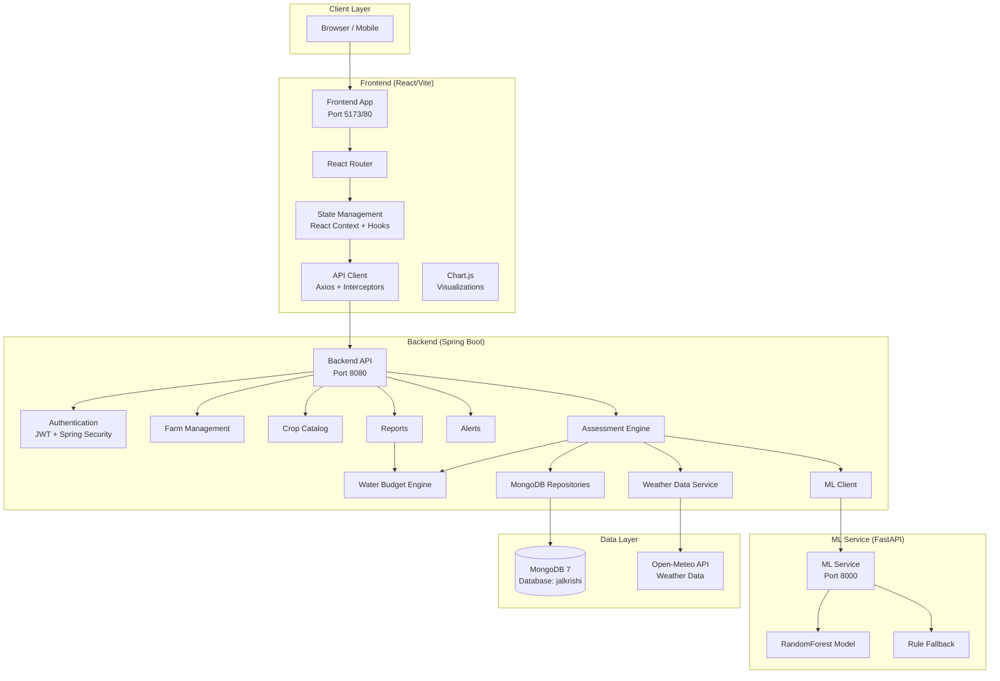
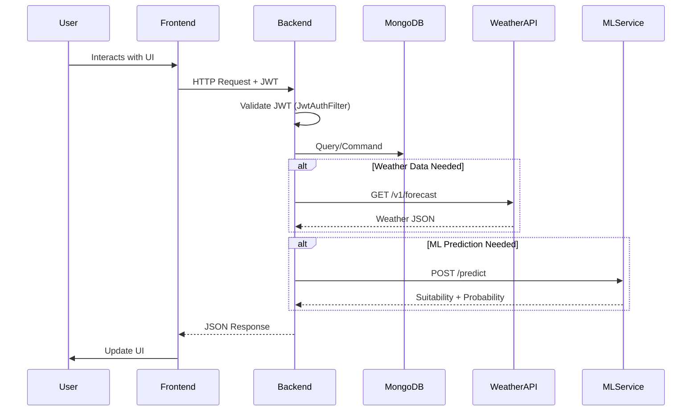
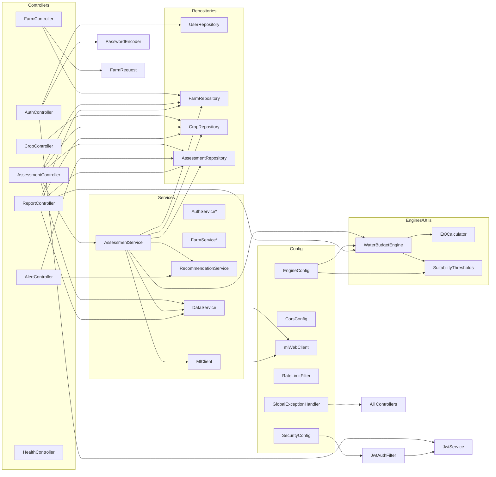
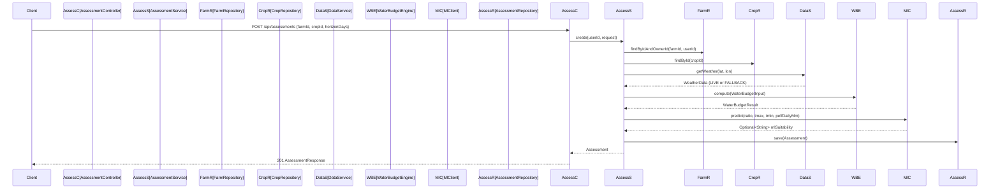
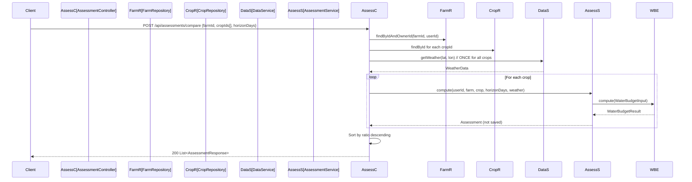
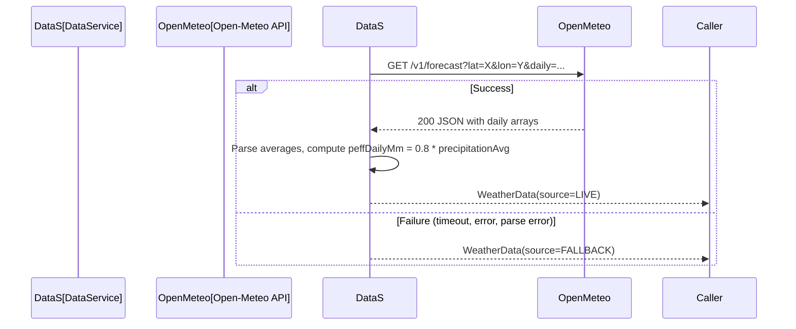
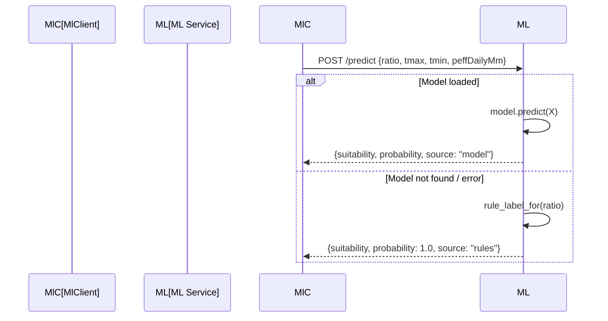
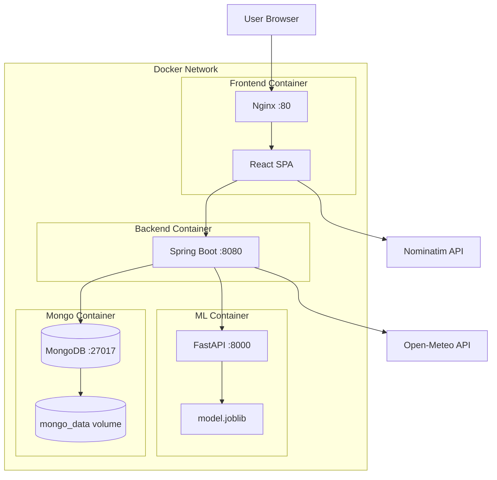
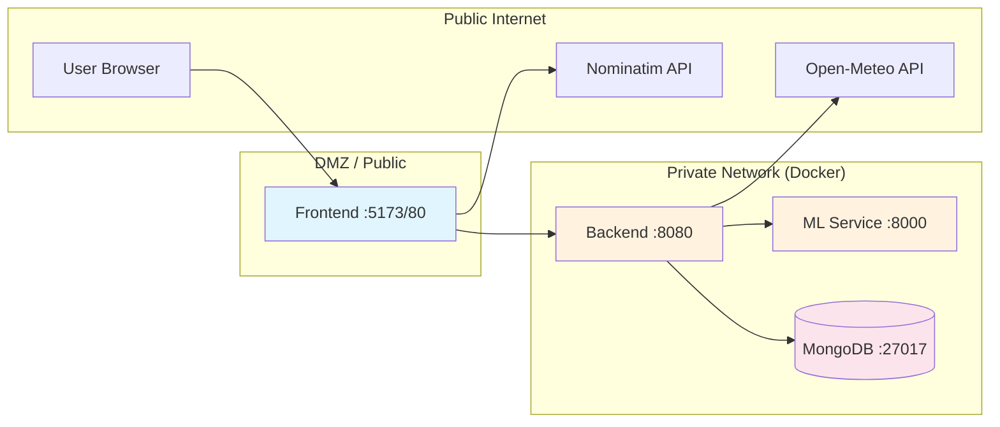

# System Architecture

## Overall System Architecture



## Frontend-Backend Communication

### Protocol
- **HTTP/REST** over JSON
- **Base URL**: `http://localhost:8080` (configurable via `VITE_API_URL`)
- **Authentication**: Bearer JWT token in `Authorization` header

### Request Flow


### API Client Implementation (`frontend/src/api.js`)
```javascript
// Axios instance with base URL from env
export const api = axios.create({
  baseURL: import.meta.env.VITE_API_URL || 'http://localhost:8080'
})

// Request interceptor: attach JWT token
api.interceptors.request.use((config) => {
  const token = getToken()
  if (token) {
    config.headers.Authorization = `Bearer ${token}`
  }
  return config
})

// Response interceptor: handle 401
api.interceptors.response.use(
  (response) => response,
  (error) => {
    if (error.response && error.response.status === 401) {
      clearToken()  // Clear invalid token
    }
    return Promise.reject(error)
  }
)
```

## Internal Module Connections

### Backend Module Dependency Graph



*Services marked with * are implicit in controllers (no separate service class)

### Key Internal Flows

#### 1. Assessment Creation Flow


#### 2. Crop Comparison Flow


## External Service Integrations

### 1. Open-Meteo Weather API
- **Purpose**: Live weather data (temperature max/min, precipitation)
- **Endpoint**: `https://api.open-meteo.com/v1/forecast`
- **Parameters**: latitude, longitude, daily=temperature_2m_max,temperature_2m_min,precipitation_sum, forecast_days=16
- **Authentication**: None required (free tier)
- **Timeout**: 5s connect, 10s read
- **Fallback**: Static values (tmax=32, tmin=21, ra=15, peffDailyMm=1.5)



### 2. ML Prediction Service
- **Purpose**: ML-enhanced suitability prediction
- **Endpoint**: `http://ml-service:8000/predict` (internal Docker network)
- **Request**: `{ratio, tmax, tmin, peffDailyMm}`
- **Response**: `{suitability, probability, source: "model"|"rules"}`
- **Timeout**: 3 seconds
- **Fallback**: Rule-based classification if model unavailable or error



### 3. MongoDB
- **Purpose**: Primary data persistence
- **Connection**: `mongodb://mongo:27017` (Docker) or `mongodb://localhost:27017` (local)
- **Database**: `jalkrishi`
- **Collections**: users, farms, crops, assessments
- **ODM**: Spring Data MongoDB

### 4. Nominatim (OpenStreetMap) - Frontend Only
- **Purpose**: Geocoding for farm location search
- **Endpoint**: `https://nominatim.openstreetmap.org/search`
- **Parameters**: q (query), format=jsonv2, limit=5
- **Rate Limit**: 1 request/second (enforced by client-side delay)
- **Authentication**: None

## Architecture Diagrams

### Component Diagram (Deployment View)



### Data Flow Diagram

```mermaid
flowchart TD
    subgraph "User Actions"
        A1[Register/Login]
        A2[Create Farm]
        A3[Run Assessment]
        A4[Compare Crops]
        A5[View Report]
        A6[Check Alerts]
        A7[View History]
    end
    
    subgraph "Frontend State"
        S1[Auth Token\nlocalStorage]
        S2[Farms List]
        S3[Crops List]
        S4[Assessments List]
        S5[Alert Prefs\nlocalStorage]
        S6[Theme\nlocalStorage]
    end
    
    subgraph "Backend Processing"
        B1[Validate JWT]
        B2[Ownership Check]
        B3[Fetch Weather]
        B4[Compute Water Budget]
        B5[ML Prediction]
        B6[Persist Assessment]
        B7[Generate Advice]
        B8[Multi-Horizon Breakdown]
    end
    
    subgraph "Data Stores"
        D1[(Users)]
        D2[(Farms)]
        D3[(Crops)]
        D4[(Assessments)]
        D5[Weather Cache\n(In-Memory)]
    end
    
    A1 --> B1
    B1 --> D1
    D1 --> S1
    
    A2 --> B1
    B1 --> B2
    B2 --> D2
    D2 --> S2
    
    A3 --> B1
    B1 --> B2
    B2 --> D2
    B2 --> D3
    B2 --> B3
    B3 --> B4
    B4 --> B5
    B5 --> B6
    B6 --> B7
    B6 --> D4
    D4 --> S4
    
    A4 --> B1
    B1 --> B2
    B2 --> D2
    B2 --> D3
    B2 --> B3
    B3 --> B4
    B4 --> D4
    D4 --> S4
    
    A5 --> B1
    B1 --> B2
    B2 --> D4
    B2 --> D2
    B2 --> D3
    B2 --> B8
    B8 --> S4
    
    A6 --> B1
    B1 --> D4
    D4 --> S4
    S5 --> S4
    
    A7 --> B1
    B1 --> D4
    D4 --> S4
```

## Communication Patterns

| Pattern | Used For | Implementation |
|---------|----------|----------------|
| **Request-Response** | All API calls | REST over HTTP/JSON |
| **Reactive Streams** | External API calls | Spring WebClient (Project Reactor) |
| **Stateless Auth** | Authentication | JWT in Authorization header |
| **Client-Side State** | UI state, preferences | React useState, useContext, localStorage |
| **Server-Side Sessions** | None (stateless) | N/A |
| **WebSockets** | None | N/A |
| **Event-Driven** | None | N/A |

## Security Boundaries



- **Frontend**: Served by Nginx, accessible publicly
- **Backend**: Only accessible via frontend (CORS restricted to frontend origin)
- **ML Service**: Internal only (no external exposure)
- **MongoDB**: Internal only (no external exposure)
- **External APIs**: Called from backend (weather) and frontend (geocoding)

## Scalability Considerations

| Component | Scaling Strategy |
|-----------|------------------|
| **Frontend** | Static files on CDN, horizontal scaling via load balancer |
| **Backend** | Stateless, horizontal scaling; connection pooling for MongoDB and HTTP clients |
| **ML Service** | Horizontal scaling; model loaded in memory per instance |
| **MongoDB** | Replica set for HA, sharding for large datasets |
| **Weather API** | Cached responses (16-day forecast), rate limiting respected |
| **Rate Limiting** | In-memory sliding window (per IP) for auth endpoints |

## Technology Choices Rationale

| Decision | Rationale |
|----------|-----------|
| **Spring Boot** | Mature ecosystem, strong MongoDB support, excellent security framework |
| **MongoDB** | Flexible schema for varying farm/assessment data, geospatial queries ready |
| **React + Vite** | Fast development, small bundle, modern tooling |
| **Tailwind CSS** | Rapid UI development, consistent design system, dark mode support |
| **Chart.js** | Lightweight, responsive charts, good React integration |
| **FastAPI** | High performance, automatic OpenAPI docs, easy ML model serving |
| **JWT** | Stateless, scalable, no server-side session storage |
| **Docker Compose** | Simple local development and production deployment |