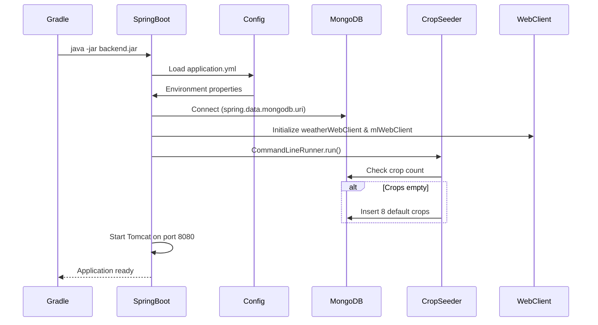
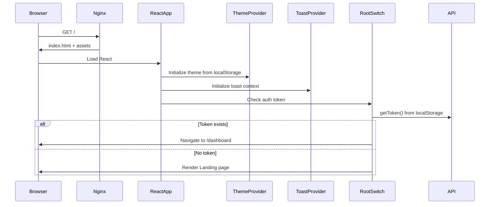
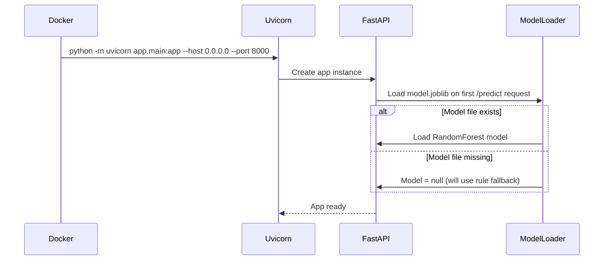
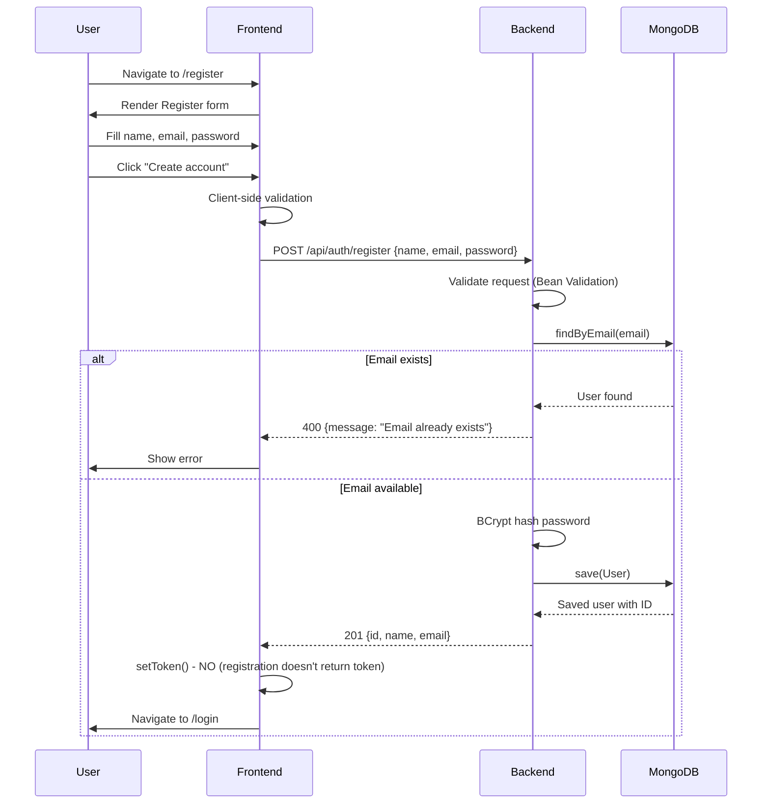
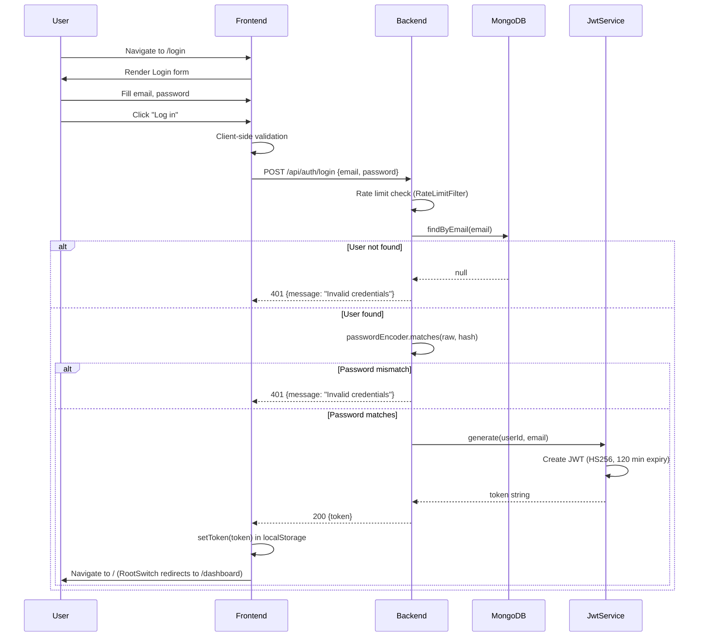
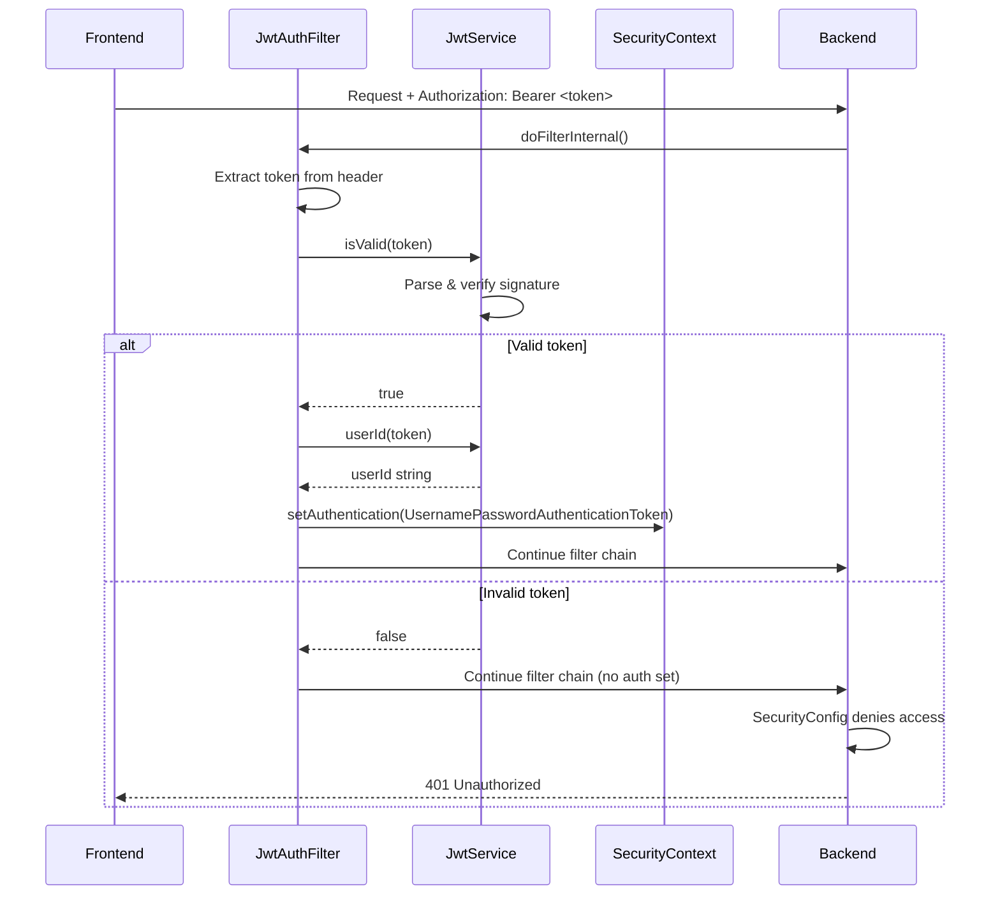
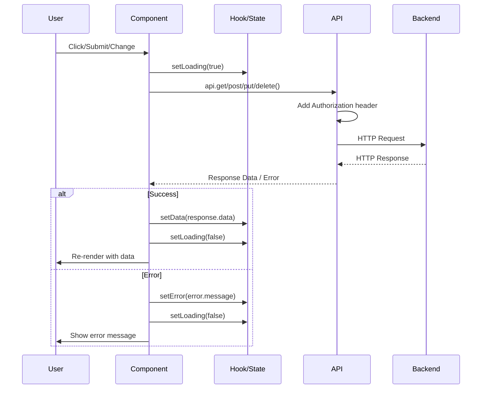
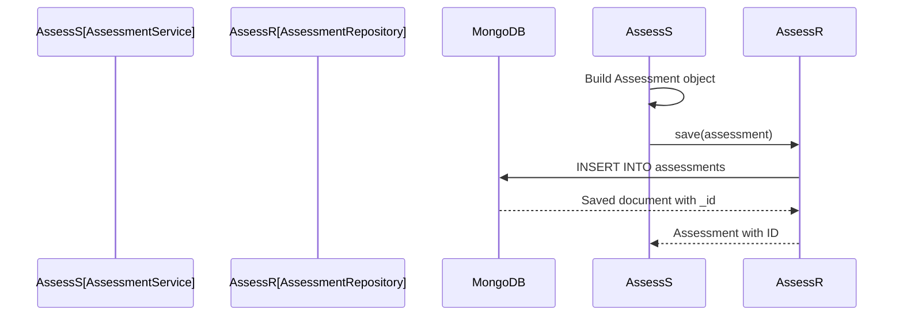
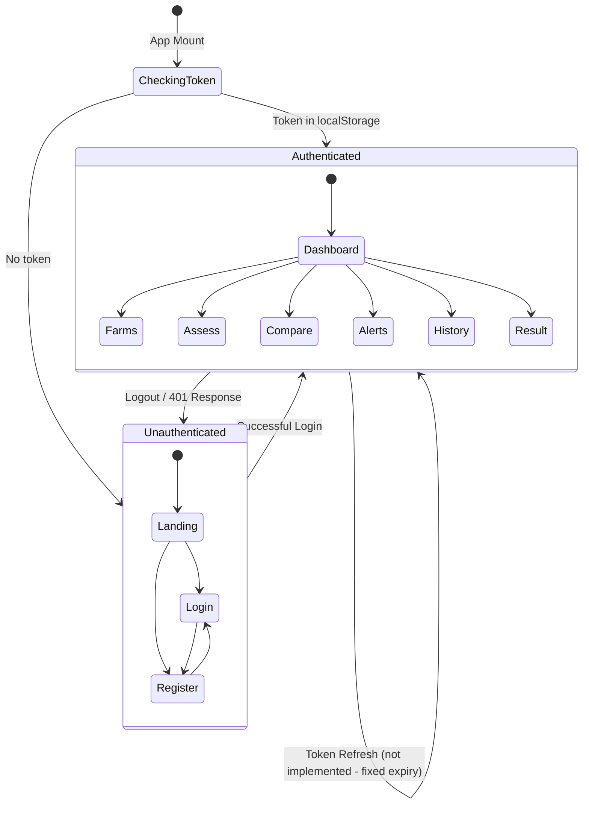
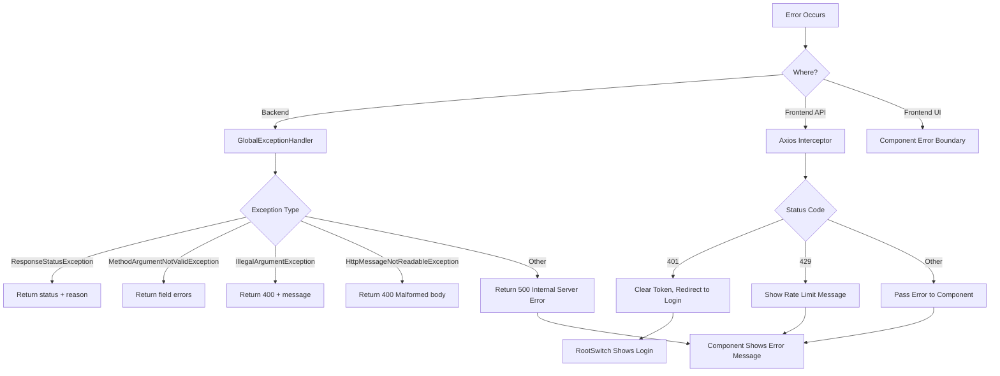

# Application Flow

## Application Startup

### Backend Startup Sequence



### Frontend Startup Sequence



### ML Service Startup Sequence



## User Registration and Login

### Registration Flow



### Login Flow



### JWT Token Structure

```json
{
  "header": {
    "alg": "HS256",
    "typ": "JWT"
  },
  "payload": {
    "sub": "userId",           // MongoDB ObjectId as string
    "email": "user@example.com",
    "iat": 1699999999,         // Issued at
    "exp": 1700007199          // Expires at (120 minutes)
  },
  "signature": "HMACSHA256(base64UrlEncode(header) + '.' + base64UrlEncode(payload), secret)"
}
```

### Token Validation Flow (Per Request)



## Major User Journeys

### Journey 1: Create a Farm

```mermaid
flowchart TD
    A[User on Dashboard] --> B[Click "Add farm" or Navigate to /farms]
    B --> C[Farms Page Loads]
    C --> D{Has Farms?}
    D -->|No| E[Empty State: "Add a farm first"]
    D -->|Yes| F[Show Farm Cards]
    E --> G[User fills Farm Form]
    F --> G
    G --> H[Optional: Search Place by Name]
    H --> I[Nominatim API Search]
    I --> J[Select Result -> Auto-fill Lat/Lon]
    G --> K[Optional: Click Map to Pick Location]
    K --> L[Leaflet Map Click -> Auto-fill Lat/Lon]
    G --> M[Optional: Calculate Water from Pump/Tank]
    M --> N[Water Math Calculations]
    G --> O[Submit Form]
    O --> P[POST /api/farms]
    P --> Q{Valid?}
    Q -->|No| R[Show Validation Errors]
    Q -->|Yes| S[Farm Saved]
    S --> T[Toast: "Farm added"]
    T --> U[Form Reset]
    U --> V[Farm List Updated]
```

**API Call**: `POST /api/farms`
```json
{
  "name": "North Field",
  "lat": 28.6139,
  "lon": 77.2090,
  "areaHa": 2.5,
  "soilType": "Loam",
  "storedWaterLitres": 0,
  "groundwaterLitres": 0,
  "storedWaterLitresPerDay": 5000,
  "groundwaterLitresPerDay": 10000,
  "country": "India",
  "state": "Delhi",
  "district": "New Delhi",
  "taluka": "Connaught Place",
  "village": "Central Delhi"
}
```

### Journey 2: Run an Assessment (3-Step Wizard)

```mermaid
flowchart TD
    A[User on Dashboard] --> B[Click "Assess a crop" or Navigate to /assess]
    B --> C[Assess Page Loads]
    C --> D[Step 1: Choose Farm]
    D --> E[GET /api/farms]
    E --> F[Select Farm from Dropdown]
    F --> G[Show Farm Summary: Area, Soil, Water Chips]
    G --> H[Click Next]
    H --> I[Step 2: Choose Crop & Period]
    I --> J[GET /api/crops]
    J --> K[Select Crop from Dropdown]
    K --> L[Show Crop Stages & Total Days]
    L --> M[Select Horizon: 30/60/90 days]
    M --> N[Click Next]
    N --> O[Step 3: Review & Run]
    O --> P[Show Summary: Farm, Area, Crop, Period, Water]
    P --> Q[Click "Run assessment"]
    Q --> R[POST /api/assessments]
    R --> S{Success?}
    S -->|No| T[Show Error]
    S -->|Yes| U[Navigate to /assessments/{id}]
    U --> V[Result Page Loads]
```

**API Call**: `POST /api/assessments`
```json
{
  "farmId": "654321abcdef",
  "cropId": "123456abcdef",
  "horizonDays": 60
}
```

**Backend Processing**:
1. Validate farm ownership
2. Validate crop exists
3. Validate horizonDays ∈ {30, 60, 90}
4. Fetch weather for farm location
5. Build WaterBudgetInput with farm water + crop stages
6. Compute water budget (ET0 → ETc → Supply/Demand → Ratio → Suitability)
7. Call ML service for prediction
8. Generate advice
9. Save assessment
10. Return assessment with ID

### Journey 3: View Assessment Result

```mermaid
flowchart TD
    A[User navigates to /assessments/{id}] --> B[Result Page Loads]
    B --> C[GET /api/reports/{id}]
    C --> D{Assessment exists & owned?}
    D -->|No| E[404 Error]
    D -->|Yes| F[Return ReportResponse]
    F --> G[Render Hero Card: Ratio Gauge, Suitability Badge]
    G --> H[Render Water Balance Card: Supply, Demand, Balance]
    H --> I[Render Weather Used Card]
    I --> J[Render Bar Chart: Supply vs Demand (30/60/90)]
    J --> K[Render Breakdown Table]
    K --> L[Render Advice Callout]
    L --> M[Show ML Suggestion if available]
    M --> N[Show Low Confidence Note if FALLBACK weather]
    N --> O[Action Buttons: Download CSV, Print, New Assessment, History, Dashboard]
```

**API Call**: `GET /api/reports/{assessmentId}`

**Response**:
```json
{
  "assessment": {
    "id": "...",
    "farmId": "...",
    "cropId": "...",
    "horizonDays": 60,
    "supplyLitres": 1500000,
    "demandLitres": 1200000,
    "balanceLitres": 300000,
    "ratio": 1.25,
    "suitability": "EXCELLENT",
    "stress": "LOW",
    "confidence": "HIGH",
    "advice": "EXCELLENT: water ratio is 1.25, driven by water supply covers crop demand.",
    "mlUsed": true,
    "mlSuitability": "EXCELLENT",
    "weather": {...},
    "createdAt": "2024-01-15T10:30:00Z"
  },
  "breakdown": [
    {"horizonDays": 30, "supplyLitres": 800000, "demandLitres": 600000, "ratio": 1.33, "suitability": "EXCELLENT"},
    {"horizonDays": 60, "supplyLitres": 1500000, "demandLitres": 1200000, "ratio": 1.25, "suitability": "EXCELLENT"},
    {"horizonDays": 90, "supplyLitres": 2100000, "demandLitres": 1900000, "ratio": 1.11, "suitability": "EXCELLENT"}
  ]
}
```

### Journey 4: Compare Crops

```mermaid
flowchart TD
    A[User on Dashboard] --> B[Click "Compare crops" or Navigate to /compare]
    B --> C[Compare Page Loads]
    C --> D[GET /api/farms, GET /api/crops]
    D --> E[Select Farm]
    E --> F[Select Multiple Crops (checkboxes)]
    F --> G[Select Horizon: 30/60/90]
    G --> H[Click "Compare crops"]
    H --> I[POST /api/assessments/compare]
    I --> J{Valid?}
    J -->|No| K[Show Error]
    J -->|Yes| L[Return Sorted Assessments]
    L --> M[Render Cards: Ratio, Suitability, Stress, Bar]
    M --> N[Highlight Winner (Highest Ratio)]
    N --> O[Render Bar Chart Comparison]
    O --> P[Render Comparison Table]
    P --> Q[User can click "View result" for any crop]
```

**API Call**: `POST /api/assessments/compare`
```json
{
  "farmId": "654321abcdef",
  "cropIds": ["crop1", "crop2", "crop3"],
  "horizonDays": 60
}
```

**Key Difference from Single Assessment**: 
- Weather fetched ONCE for all crops
- Assessments NOT saved to database
- Results sorted by ratio descending
- Winner highlighted

### Journey 5: Check Alerts

```mermaid
flowchart TD
    A[User on Dashboard] --> B[Click "Alerts" or Navigate to /alerts]
    B --> C[Alerts Page Loads]
    C --> D[GET /api/alerts]
    D --> E[Filter by Stress=HIGH]
    E --> F[Load User Preferences from localStorage]
    F --> G[Filter out Hidden/Snoozed Alerts]
    G --> H[Render Alert Cards]
    H --> I[Each Card: Message, Date, Actions]
    I --> J[Actions: View Result, Hide, Snooze 1 Day]
    J --> K[Hide/Snooze -> Update localStorage]
    K --> L[Toast Confirmation]
    L --> M[UI Updates Immediately]
```

**API Call**: `GET /api/alerts`
- Returns assessments with `stress = HIGH` for current user
- Client-side filtering for hidden/snoozed (stored in localStorage)

### Journey 6: View History

```mermaid
flowchart TD
    A[User on Dashboard] --> B[Click "History" or Navigate to /history]
    B --> C[History Page Loads]
    C --> D[GET /api/assessments, /api/farms, /api/crops]
    D --> E[Merge Data: Farm Names, Crop Names]
    E --> F[Render Filter Dropdown: All/Excellent/Good/Risky/Not Recommended]
    F --> G[Render Sortable Table: Date, Farm, Crop, Horizon, Ratio, Suitability]
    G --> H[User can Sort by any column]
    H --> I[User can Filter by Suitability]
    I --> J[Pagination: 10 per page]
    J --> K[Click "View" -> Navigate to /assessments/{id}]
```

## Frontend Events and API Requests

### Event Flow Diagram



### Key API Integration Points

| Page/Component | API Calls | Trigger |
|----------------|-----------|---------|
| **Login** | `POST /api/auth/login` | Form submit |
| **Register** | `POST /api/auth/register` | Form submit |
| **Dashboard** | `GET /api/auth/me`, `GET /api/farms`, `GET /api/assessments`, `GET /api/alerts` | Mount |
| **Farms** | `GET /api/farms`, `POST /api/farms`, `DELETE /api/farms/{id}` | Mount, Form submit, Delete click |
| **Assess** | `GET /api/farms`, `GET /api/crops`, `POST /api/assessments` | Mount, Wizard complete |
| **Result** | `GET /api/reports/{id}` | Mount |
| **Compare** | `GET /api/farms`, `GET /api/crops`, `POST /api/assessments/compare` | Mount, Form submit |
| **Alerts** | `GET /api/alerts` | Mount |
| **History** | `GET /api/assessments`, `GET /api/farms`, `GET /api/crops` | Mount |

## Backend Processing Details

### Water Budget Computation Flow

```mermaid
flowchart TD
    A[WaterBudgetInput] --> B[Validate Inputs]
    B --> C{Valid?}
    C -->|No| D[Throw IllegalArgumentException]
    C -->|Yes| E[Calculate ET0]
    E --> F[Et0Calculator.et0(tmax, tmin, ra)]
    F --> G[Calculate Demand]
    G --> H[Iterate through crop stages for horizonDays]
    H --> I[Sum Kc * ET0 for each day]
    I --> J[Demand = TotalKcDays * ET0 * AreaHa * 10000]
    J --> K[Calculate Supply]
    K --> L[EffectiveRainfall = peffDailyMm * HorizonDays * AreaHa * 10000]
    L --> M[Supply = EffectiveRainfall + StoredWater + Groundwater]
    M --> N[Balance = Supply - Demand]
    N --> O[Ratio = Supply / Demand]
    O --> P[Classify Suitability]
    P --> Q[thresholds: excellent=1.0, good=0.8, risky=0.6]
    Q --> R[Determine Stress from Suitability]
    R --> S[Return WaterBudgetResult]
```

### ET0 Calculation (Hargreaves-Samani)

```java
// Et0Calculator.java
public static double et0(double tmax, double tmin, double ra) {
    if (tmax < tmin) throw new IllegalArgumentException("tmax must be >= tmin");
    if (tmax == tmin) return 0.0;
    double tmean = (tmax + tmin) / 2.0;
    return 0.0023 * (tmean + 17.8) * Math.sqrt(tmax - tmin) * ra;
}
```

**Formula**: `ET0 = 0.0023 × (Tmean + 17.8) × √(Tmax - Tmin) × Ra`
- `Tmean = (Tmax + Tmin) / 2`
- `Ra` = Extraterrestrial radiation (fixed at 15.0 mm/day equivalent)
- Result in mm/day

### Demand Calculation

```java
// WaterBudgetEngine.calculateDemand()
double totalKcDays = 0.0;
int day = 1;
int stageIndex = 0;
int daysInCurrentStage = 0;

while (day <= horizonDays) {
    if (stageIndex < stages.size()) {
        currentStage = stages.get(stageIndex);
        if (daysInCurrentStage >= currentStage.days()) {
            stageIndex++;
            daysInCurrentStage = 0;
            if (stageIndex < stages.size()) {
                currentStage = stages.get(stageIndex);
            }
        }
    }
    // After last stage, keep using the last stage
    totalKcDays += currentStage.kc();
    daysInCurrentStage++;
    day++;
}

return totalKcDays * et0 * areaHa * 10000;  // Litres
```

### Supply Calculation

```java
// WaterBudgetEngine.calculateSupply()
double effectiveRainfallLitres = (peffDailyMm * horizonDays) * areaHa * 10000;
return effectiveRainfallLitres + storedWaterLitres + groundwaterLitres;
```

### Suitability Classification

```java
// WaterBudgetEngine.classify()
if (ratio >= thresholds.excellent()) return Suitability.EXCELLENT;      // >= 1.0
else if (ratio >= thresholds.good()) return Suitability.GOOD;          // >= 0.8
else if (ratio >= thresholds.risky()) return Suitability.RISKY;        // >= 0.6
else return Suitability.NOT_RECOMMENDED;                               // < 0.6
```

### Stress Mapping

```java
// WaterBudgetEngine.stressFor()
switch (suitability) {
    case EXCELLENT -> Stress.LOW;
    case GOOD -> Stress.LOW_MODERATE;
    case RISKY -> Stress.MODERATE;
    case NOT_RECOMMENDED -> Stress.HIGH;
}
```

## Database Operations

### Assessment Creation (Write)



### Assessment Queries (Read)

| Query | Method | Use Case |
|-------|--------|----------|
| Find by owner, sort by createdAt desc | `findByOwnerIdOrderByCreatedAtDesc` | Dashboard, History |
| Find by ID and owner | `findByIdAndOwnerId` | Result, Report, Delete |
| Find by owner and stress=HIGH | `findByOwnerIdAndStressOrderByCreatedAtDesc` | Alerts |

## API Responses and Frontend Updates

### Response Format Standards

**Success Response** (2xx):
```json
{
  "id": "...",
  "name": "...",
  ...
}
```

**Error Response** (4xx, 5xx):
```json
{
  "timestamp": "2024-01-15T10:30:00.123Z",
  "status": 400,
  "error": "Bad Request",
  "message": "Validation failed: name must not be blank; areaHa must be > 0"
}
```

### Frontend Error Handling

```javascript
// In api.js interceptor
api.interceptors.response.use(
  (response) => response,
  (error) => {
    if (error.response && error.response.status === 401) {
      clearToken()  // Auto-logout on expired token
    }
    return Promise.reject(error)
  }
)

// In components
try {
  const res = await api.post("/api/assessments", data)
  navigate("/assessments/" + res.data.id)
} catch (err) {
  setSaveError(err.response?.data?.message || "Could not run assessment")
}
```

### Loading States

| State | Implementation |
|-------|----------------|
| **Page Load** | `useEffect` with `setLoading(true)`, skeleton screens |
| **Form Submit** | `setSaving(true)`, button disabled, loading spinner |
| **Data Fetch** | `Promise.all` for parallel requests, individual error handling |

## Authentication State Management



## Error Handling Flow

