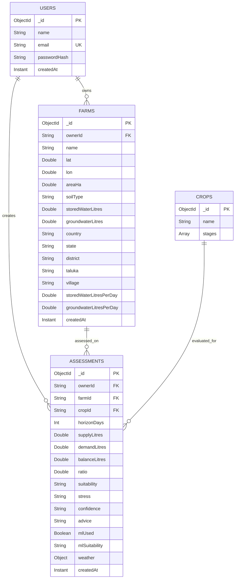
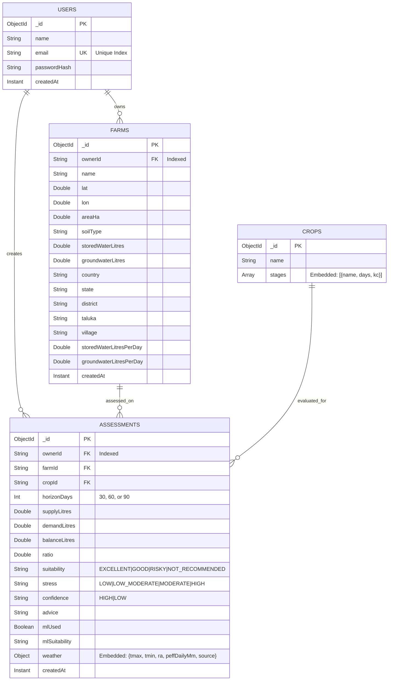

# Database Documentation

## Database Technology and Connection Configuration

### Technology
- **Database**: MongoDB 7.x
- **ODM**: Spring Data MongoDB 3.x
- **Connection**: Reactive/Blocking driver (Spring Data uses blocking by default)

### Connection Configuration

**application.yml**:
```yaml
spring:
  data:
    mongodb:
      database: jalkrishi
      uri: ${SPRING_DATA_MONGODB_URI:mongodb://localhost:27017}
```

**Docker Compose** (production):
```yaml
services:
  mongo:
    image: mongo:7
    volumes:
      - mongo_data:/data/db
  backend:
    environment:
      SPRING_DATA_MONGODB_URI: mongodb://mongo:27017
```

**Local Development**:
- Default: `mongodb://localhost:27017`
- Database name: `jalkrishi`
- No authentication required for local development

### Connection Pool Settings (WebClientConfig)
```java
// HTTP Client connection pool (for external APIs, not MongoDB)
MAX_CONNECTIONS = 50
PENDING_ACQUIRE_MAX_COUNT = 1000
PENDING_ACQUIRE_TIMEOUT = 5 seconds
CONNECTION_LIFETIME = 5 minutes
```

## Complete Database Schema

### Collections Overview

| Collection | Document Count (Typical) | Purpose |
|------------|-------------------------|---------|
| `users` | 1 per registered user | User accounts and authentication |
| `farms` | Multiple per user | Farm definitions with location and water data |
| `crops` | 8 (seeded) | Crop catalog with growth stages |
| `assessments` | Multiple per user | Water budget assessment results |

---

## Collection: users

### Document Structure
```json
{
  "_id": ObjectId("..."),
  "name": "John Doe",
  "email": "john@example.com",
  "passwordHash": "$2a$10$...",
  "createdAt": ISODate("2024-01-15T10:30:00.000Z")
}
```

### Field Definitions

| Field | Type | Required | Constraints | Description |
|-------|------|----------|-------------|-------------|
| `_id` | ObjectId | Yes | Primary Key | MongoDB generated unique identifier |
| `name` | String | Yes | - | User's display name |
| `email` | String | Yes | Unique, Indexed | User's email (login identifier) |
| `passwordHash` | String | Yes | BCrypt hash | Securely hashed password |
| `createdAt` | Instant | Yes | Default: now | Account creation timestamp |

### Indexes
```javascript
// Unique index on email (enforced by @Indexed(unique = true))
db.users.createIndex({ "email": 1 }, { unique: true })
```

### Java Entity
```java
@Document(collection = "users")
public class User {
    @Id
    private String id;
    
    private String name;
    
    @Indexed(unique = true)
    private String email;
    
    private String passwordHash;
    
    private Instant createdAt = Instant.now();
}
```

### Sample Record
```json
{
  "_id": "65a1b2c3d4e5f6789012345",
  "name": "Rajesh Kumar",
  "email": "rajesh.farmer@example.com",
  "passwordHash": "$2a$10$N9qo8uLOickgx2ZMRZoMye...",
  "createdAt": "2024-01-15T10:30:00.000Z"
}
```

---

## Collection: farms

### Document Structure
```json
{
  "_id": ObjectId("..."),
  "ownerId": "65a1b2c3d4e5f6789012345",
  "name": "North Field",
  "lat": 28.6139,
  "lon": 77.2090,
  "areaHa": 2.5,
  "soilType": "Loam",
  "storedWaterLitres": 50000,
  "groundwaterLitres": 100000,
  "country": "India",
  "state": "Delhi",
  "district": "New Delhi",
  "taluka": "Connaught Place",
  "village": "Central Delhi",
  "storedWaterLitresPerDay": 5000,
  "groundwaterLitresPerDay": 10000,
  "createdAt": ISODate("2024-01-15T11:00:00.000Z")
}
```

### Field Definitions

| Field | Type | Required | Constraints | Description |
|-------|------|----------|-------------|-------------|
| `_id` | ObjectId | Yes | Primary Key | MongoDB generated unique identifier |
| `ownerId` | String | Yes | Indexed, FK → users._id | Reference to owning user |
| `name` | String | Yes | Not blank | Farm display name |
| `lat` | Double | Yes | -90 to 90 | Latitude in decimal degrees |
| `lon` | Double | Yes | -180 to 180 | Longitude in decimal degrees |
| `areaHa` | Double | Yes | > 0 | Farm area in hectares |
| `soilType` | String | No | Enum: Sandy, Loam, Clay | Soil classification |
| `storedWaterLitres` | Double | Yes | >= 0 | Static stored water (tanks, ponds) |
| `groundwaterLitres` | Double | Yes | >= 0 | Static groundwater available |
| `country` | String | No | Max 100 chars | Country name |
| `state` | String | No | Max 100 chars | State/province name |
| `district` | String | No | Max 100 chars | District name |
| `taluka` | String | No | Max 100 chars | Taluka/tehsil name |
| `village` | String | No | Max 100 chars | Village name |
| `storedWaterLitresPerDay` | Double | Yes | >= 0, Default: 0 | Daily stored water replenishment |
| `groundwaterLitresPerDay` | Double | Yes | >= 0, Default: 0 | Daily groundwater recharge |
| `createdAt` | Instant | Yes | Default: now | Farm creation timestamp |

### Indexes
```javascript
// Index on ownerId for user's farm queries
db.farms.createIndex({ "ownerId": 1 })
```

### Java Entity
```java
@Document(collection = "farms")
public class Farm {
    @Id
    private String id;
    
    @Indexed
    private String ownerId;
    
    @NotBlank
    private String name;
    
    @NotNull @Min(-90) @Max(90)
    private Double lat;
    
    @NotNull @Min(-180) @Max(180)
    private Double lon;
    
    @NotNull @Positive
    private Double areaHa;
    
    private String soilType;
    
    @NotNull @PositiveOrZero
    private Double storedWaterLitres;
    
    @NotNull @PositiveOrZero
    private Double groundwaterLitres;
    
    @Size(max = 100) private String country;
    @Size(max = 100) private String state;
    @Size(max = 100) private String district;
    @Size(max = 100) private String taluka;
    @Size(max = 100) private String village;
    
    @NotNull @PositiveOrZero
    private Double storedWaterLitresPerDay = 0.0;
    
    @NotNull @PositiveOrZero
    private Double groundwaterLitresPerDay = 0.0;
    
    private Instant createdAt = Instant.now();
}
```

### Sample Record
```json
{
  "_id": "65a1b2c3d4e5f6789012346",
  "ownerId": "65a1b2c3d4e5f6789012345",
  "name": "North Field",
  "lat": 28.6139,
  "lon": 77.2090,
  "areaHa": 2.5,
  "soilType": "Loam",
  "storedWaterLitres": 50000,
  "groundwaterLitres": 100000,
  "country": "India",
  "state": "Delhi",
  "district": "New Delhi",
  "taluka": "Connaught Place",
  "village": "Central Delhi",
  "storedWaterLitresPerDay": 5000,
  "groundwaterLitresPerDay": 10000,
  "createdAt": "2024-01-15T11:00:00.000Z"
}
```

---

## Collection: crops

### Document Structure
```json
{
  "_id": ObjectId("..."),
  "name": "Rice",
  "stages": [
    {"name": "Initial", "days": 30, "kc": 1.05},
    {"name": "Development", "days": 30, "kc": 1.15},
    {"name": "Mid", "days": 60, "kc": 1.20},
    {"name": "Late", "days": 30, "kc": 0.90}
  ]
}
```

### Field Definitions

| Field | Type | Required | Description |
|-------|------|----------|-------------|
| `_id` | ObjectId | Yes | Primary Key |
| `name` | String | Yes | Crop name (unique in practice) |
| `stages` | Array | Yes | Growth stages with Kc values |

### Stage Sub-document

| Field | Type | Required | Description |
|-------|------|----------|-------------|
| `name` | String | Yes | Stage name (Initial, Development, Mid, Late) |
| `days` | Integer | Yes | Duration in days |
| `kc` | Double | Yes | Crop coefficient (FAO-56 style) |

### Indexes
```javascript
// No explicit indexes beyond _id
```

### Java Entity
```java
@Document(collection = "crops")
public class Crop {
    @Id
    private String id;
    
    private String name;
    
    private List<Stage> stages;
    
    public static class Stage {
        private String name;
        private int days;
        private double kc;
    }
}
```

### Seeded Data (CropSeeder.java)

| Crop | Stages (name, days, kc) | Total Days |
|------|------------------------|------------|
| **Rice** | Initial(30,1.05), Development(30,1.15), Mid(60,1.20), Late(30,0.90) | 150 |
| **Wheat** | Initial(20,0.40), Development(30,0.80), Mid(50,1.15), Late(30,0.30) | 130 |
| **Cotton** | Initial(30,0.35), Development(50,0.65), Mid(55,1.15), Late(45,0.60) | 180 |
| **Sugarcane** | Initial(30,0.40), Development(60,1.00), Mid(150,1.25), Late(60,0.75) | 300 |
| **Maize** | Initial(25,0.30), Development(35,0.75), Mid(40,1.20), Late(30,0.60) | 130 |
| **Soybean** | Initial(20,0.40), Development(30,0.80), Mid(50,1.10), Late(30,0.45) | 130 |
| **Tomato** | Initial(30,0.60), Development(40,0.95), Mid(50,1.15), Late(30,0.80) | 150 |
| **Onion** | Initial(25,0.70), Development(40,0.95), Mid(50,1.05), Late(25,0.75) | 140 |

### Sample Record
```json
{
  "_id": "65a1b2c3d4e5f6789012347",
  "name": "Wheat",
  "stages": [
    {"name": "Initial", "days": 20, "kc": 0.40},
    {"name": "Development", "days": 30, "kc": 0.80},
    {"name": "Mid", "days": 50, "kc": 1.15},
    {"name": "Late", "days": 30, "kc": 0.30}
  ]
}
```

---

## Collection: assessments

### Document Structure
```json
{
  "_id": ObjectId("..."),
  "ownerId": "65a1b2c3d4e5f6789012345",
  "farmId": "65a1b2c3d4e5f6789012346",
  "cropId": "65a1b2c3d4e5f6789012347",
  "horizonDays": 60,
  "supplyLitres": 1500000.0,
  "demandLitres": 1200000.0,
  "balanceLitres": 300000.0,
  "ratio": 1.25,
  "suitability": "EXCELLENT",
  "stress": "LOW",
  "confidence": "HIGH",
  "advice": "EXCELLENT: water ratio is 1.25, driven by water supply covers crop demand.",
  "mlUsed": true,
  "mlSuitability": "EXCELLENT",
  "weather": {
    "tmax": 32.5,
    "tmin": 21.0,
    "ra": 15.0,
    "peffDailyMm": 2.1,
    "source": "LIVE"
  },
  "createdAt": ISODate("2024-01-15T11:30:00.000Z")
}
```

### Field Definitions

| Field | Type | Required | Description |
|-------|------|----------|-------------|
| `_id` | ObjectId | Yes | Primary Key |
| `ownerId` | String | Yes | Indexed, FK → users._id |
| `farmId` | String | Yes | FK → farms._id |
| `cropId` | String | Yes | FK → crops._id |
| `horizonDays` | Integer | Yes | Assessment period (30, 60, or 90) |
| `supplyLitres` | Double | Yes | Total water supply in litres |
| `demandLitres` | Double | Yes | Total crop water demand in litres |
| `balanceLitres` | Double | Yes | Supply - Demand (can be negative) |
| `ratio` | Double | Yes | Supply / Demand |
| `suitability` | String | Yes | Enum: EXCELLENT, GOOD, RISKY, NOT_RECOMMENDED |
| `stress` | String | Yes | Enum: LOW, LOW_MODERATE, MODERATE, HIGH |
| `confidence` | String | Yes | Enum: HIGH (live weather), LOW (fallback) |
| `advice` | String | Yes | Human-readable recommendation |
| `mlUsed` | Boolean | Yes | Whether ML prediction was used |
| `mlSuitability` | String | No | ML prediction result (if mlUsed=true) |
| `weather` | Object | Yes | Weather snapshot at assessment time |
| `createdAt` | Instant | Yes | Assessment creation timestamp |

### Weather Sub-document

| Field | Type | Description |
|-------|------|-------------|
| `tmax` | Double | Max temperature (°C) |
| `tmin` | Double | Min temperature (°C) |
| `ra` | Double | Extraterrestrial radiation (mm/day) |
| `peffDailyMm` | Double | Effective daily rainfall (mm) |
| `source` | String | "LIVE" or "FALLBACK" |

### Indexes
```javascript
// Index on ownerId for user's assessment queries
db.assessments.createIndex({ "ownerId": 1 })

// Compound index for alerts query (ownerId + stress + createdAt)
db.assessments.createIndex({ "ownerId": 1, "stress": 1, "createdAt": -1 })

// Index for findByIdAndOwnerId
db.assessments.createIndex({ "_id": 1, "ownerId": 1 })
```

### Java Entity
```java
@Document(collection = "assessments")
public class Assessment {
    @Id
    private String id;
    
    @Indexed
    private String ownerId;
    
    private String farmId;
    private String cropId;
    private int horizonDays;
    private double supplyLitres;
    private double demandLitres;
    private double balanceLitres;
    private double ratio;
    private Suitability suitability;
    private Stress stress;
    private Confidence confidence;
    private String advice;
    private boolean mlUsed;
    private String mlSuitability;
    private WeatherSnapshot weather;
    private Instant createdAt = Instant.now();
}
```

### Enums

```java
// Suitability.java
public enum Suitability {
    EXCELLENT, GOOD, RISKY, NOT_RECOMMENDED
}

// Stress.java
public enum Stress {
    LOW, LOW_MODERATE, MODERATE, HIGH
}

// Confidence.java
public enum Confidence {
    HIGH, LOW
}
```

### Sample Record
```json
{
  "_id": "65a1b2c3d4e5f6789012348",
  "ownerId": "65a1b2c3d4e5f6789012345",
  "farmId": "65a1b2c3d4e5f6789012346",
  "cropId": "65a1b2c3d4e5f6789012347",
  "horizonDays": 60,
  "supplyLitres": 1500000.0,
  "demandLitres": 1200000.0,
  "balanceLitres": 300000.0,
  "ratio": 1.25,
  "suitability": "EXCELLENT",
  "stress": "LOW",
  "confidence": "HIGH",
  "advice": "EXCELLENT: water ratio is 1.25, driven by water supply covers crop demand.",
  "mlUsed": true,
  "mlSuitability": "EXCELLENT",
  "weather": {
    "tmax": 32.5,
    "tmin": 21.0,
    "ra": 15.0,
    "peffDailyMm": 2.1,
    "source": "LIVE"
  },
  "createdAt": "2024-01-15T11:30:00.000Z"
}
```

---

## Relationships Between Tables

### Entity Relationship Diagram



### Relationship Details

| Relationship | Type | Description |
|--------------|------|-------------|
| User → Farms | One-to-Many | One user can have multiple farms |
| User → Assessments | One-to-Many | One user can create multiple assessments |
| Farm → Assessments | One-to-Many | One farm can have multiple assessments |
| Crop → Assessments | One-to-Many | One crop can be assessed multiple times |
| Assessment → User | Many-to-One | Each assessment belongs to one user |
| Assessment → Farm | Many-to-One | Each assessment references one farm |
| Assessment → Crop | Many-to-One | Each assessment references one crop |

### Referential Integrity

**Application-Level Enforcement** (not database-enforced):
- `Farm.ownerId` must reference existing `User._id`
- `Assessment.ownerId` must reference existing `User._id`
- `Assessment.farmId` must reference existing `Farm._id` owned by same user
- `Assessment.cropId` must reference existing `Crop._id`

**Validation in Controllers**:
```java
// FarmController - ownership check
Farm farm = farmRepository.findByIdAndOwnerId(id, userId);
if (farm == null) {
    throw new ResponseStatusException(HttpStatus.NOT_FOUND, "Farm not found");
}

// AssessmentController - ownership check
Assessment assessment = assessmentRepository.findByIdAndOwnerId(id, userId);
if (assessment == null) {
    throw new ResponseStatusException(HttpStatus.NOT_FOUND, "Assessment not found");
}

// AssessmentService - farm ownership validation
Farm farm = farmRepository.findByIdAndOwnerId(req.farmId(), userId);
if (farm == null) {
    throw new ResponseStatusException(HttpStatus.NOT_FOUND, "Farm not found");
}
```

---

## Database Operations and Query Flow

### Common Query Patterns

#### 1. User Registration
```java
// AuthController.register()
Optional<User> existing = userRepository.findByEmail(request.getEmail());
if (existing.isPresent()) {
    return ResponseEntity.badRequest().body(Map.of("message", "Email already exists"));
}
User user = new User(request.getName(), request.getEmail(), passwordHash);
User savedUser = userRepository.save(user);
```

#### 2. User Login
```java
// AuthController.login()
Optional<User> userOpt = userRepository.findByEmail(request.getEmail());
if (userOpt.isEmpty() || !passwordEncoder.matches(request.getPassword(), user.getPasswordHash())) {
    return ResponseEntity.status(HttpStatus.UNAUTHORIZED).body(Map.of("message", "Invalid credentials"));
}
```

#### 3. List User's Farms
```java
// FarmController.list()
List<Farm> farms = farmRepository.findByOwnerId(userId);
```

#### 4. Create Assessment
```java
// AssessmentService.create()
Farm farm = farmRepository.findByIdAndOwnerId(req.farmId(), userId);
Crop crop = cropRepository.findById(req.cropId()).orElse(null);
WeatherData weather = dataService.getWeather(farm.getLat(), farm.getLon());
Assessment assessment = compute(userId, farm, crop, req.horizonDays(), weather);
// ... ML call ...
return assessmentRepository.save(assessment);
```

#### 5. List User's Assessments (Dashboard/History)
```java
// AssessmentController.list()
List<Assessment> assessments = assessmentRepository.findByOwnerIdOrderByCreatedAtDesc(userId);
```

#### 6. Get Alerts (High Stress)
```java
// AlertController.getAlerts()
List<Assessment> assessments = assessmentRepository.findByOwnerIdAndStressOrderByCreatedAtDesc(userId, Stress.HIGH);
```

#### 7. Get Report (Multi-Horizon Breakdown)
```java
// ReportController.getReport()
Assessment assessment = assessmentRepository.findByIdAndOwnerId(assessmentId, userId);
Farm farm = farmRepository.findByIdAndOwnerId(assessment.getFarmId(), userId);
Crop crop = cropRepository.findById(assessment.getCropId()).orElse(null);
// Recompute for 30, 60, 90 days
```

---

## ER Diagram (Mermaid)



---

## Indexes Summary

| Collection | Index | Type | Purpose |
|------------|-------|------|---------|
| `users` | `{email: 1}` | Unique | Fast email lookup for login, prevent duplicates |
| `farms` | `{ownerId: 1}` | Single | Query farms by owner |
| `assessments` | `{ownerId: 1}` | Single | Query assessments by owner |
| `assessments` | `{ownerId: 1, stress: 1, createdAt: -1}` | Compound | Alerts query (high stress, sorted by date) |
| `assessments` | `{_id: 1, ownerId: 1}` | Compound | Secure find by ID and owner |

---

## Data Migration and Seeding

### Crop Seeding (Automatic on Startup)
```java
// CropSeeder.java - CommandLineRunner
@Override
public void run(String... args) {
    if (cropRepository.count() == 0) {
        List<Crop> crops = List.of(
            new Crop("Rice", List.of(...)),
            new Crop("Wheat", List.of(...)),
            // ... 6 more crops
        );
        cropRepository.saveAll(crops);
    }
}
```

### Manual Data Operations

**Reset Database** (Docker):
```bash
docker compose down -v  # Removes mongo_data volume
docker compose up -d    # Fresh start, crops re-seeded
```

**Backup/Restore**:
```bash
# Backup
docker exec mongo mongodump --db jalkrishi --out /data/backup

# Restore
docker exec mongo mongorestore --db jalkrishi /data/backup/jalkrishi
```

---

## Performance Considerations

| Aspect | Current Implementation | Recommendation |
|--------|----------------------|----------------|
| **Farm Queries** | Indexed on `ownerId` | Good for user-scoped queries |
| **Assessment Queries** | Indexed on `ownerId`, compound for alerts | Good |
| **Crop Queries** | No index (only 8 docs) | Full scan acceptable |
| **Weather Data** | Not cached (fetched per assessment) | Consider caching for same location |
| **ML Calls** | Synchronous, per assessment create | Async or batch for comparison |

### Query Optimization Notes

1. **Assessment List**: Uses `findByOwnerIdOrderByCreatedAtDesc` - efficient with index
2. **Alerts**: Uses compound index `{ownerId, stress, createdAt}` - optimal
3. **Report Generation**: Recomputes water budget for 3 horizons - no additional DB queries
4. **Crop Comparison**: Fetches weather ONCE, computes in memory - efficient

---

## Schema Evolution Notes

### Version History
- **v1.0**: Initial schema with users, farms, crops, assessments
- **v1.1**: Added `storedWaterLitresPerDay` and `groundwaterLitresPerDay` to farms
- **v1.2**: Added `country`, `state`, `district`, `taluka`, `village` to farms
- **v1.3**: Added `mlUsed`, `mlSuitability`, `weather` snapshot to assessments

### Migration Strategy
- Spring Data MongoDB handles schema-less documents
- New fields added with default values in Java entities
- Existing documents work without migration (null/missing fields get defaults)
- `@NotNull` validation only applies to new documents

### Future Schema Changes (Planned)
- Add `lastModified` timestamp to all entities
- Add geospatial index on farm location for proximity queries
- Consider embedding crop stages in assessment for historical accuracy