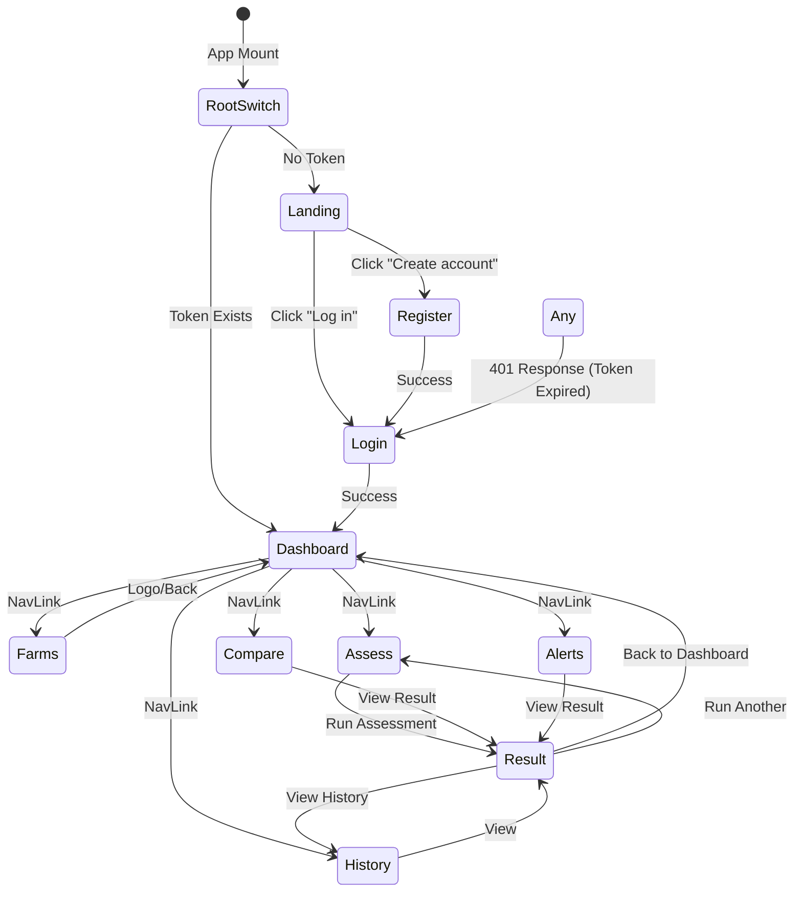
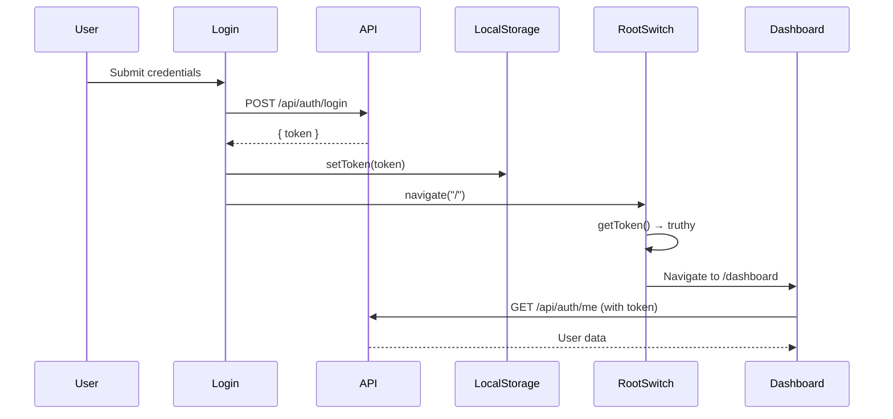
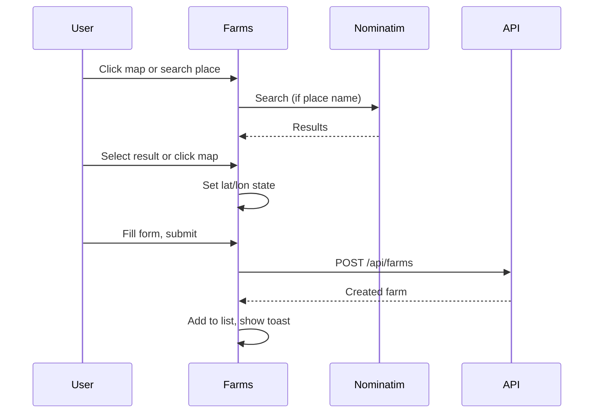
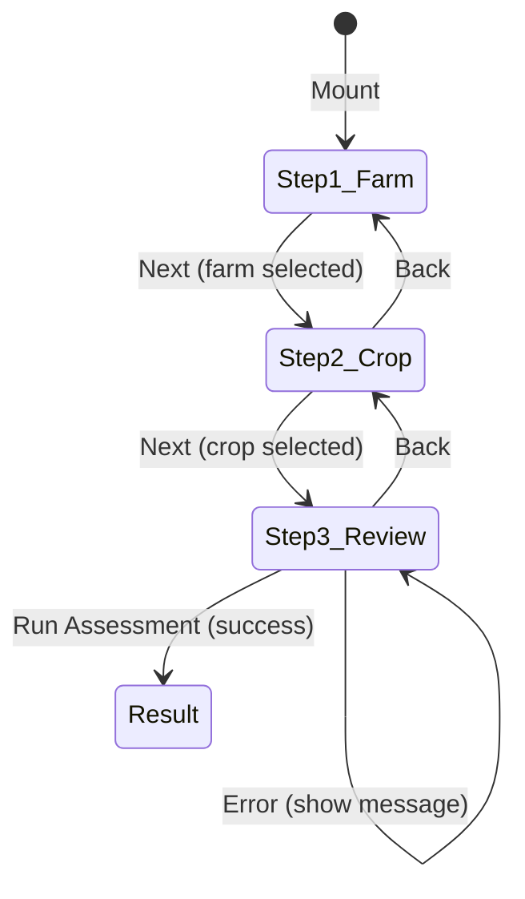
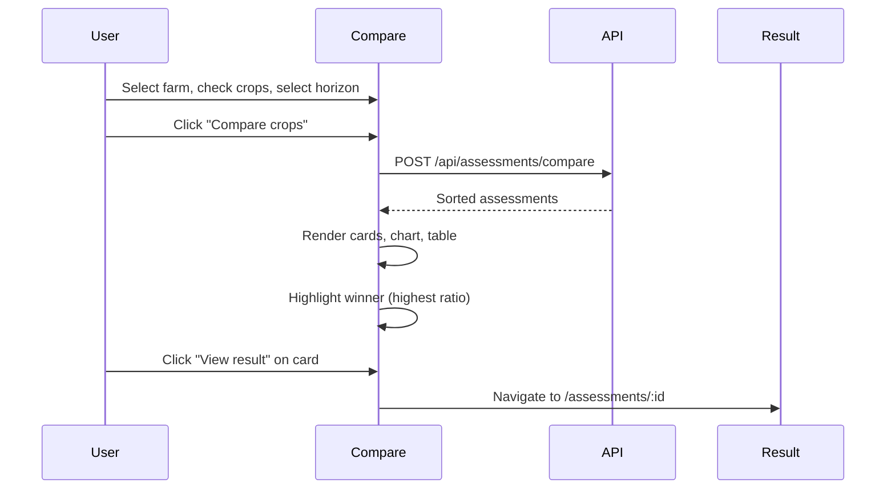
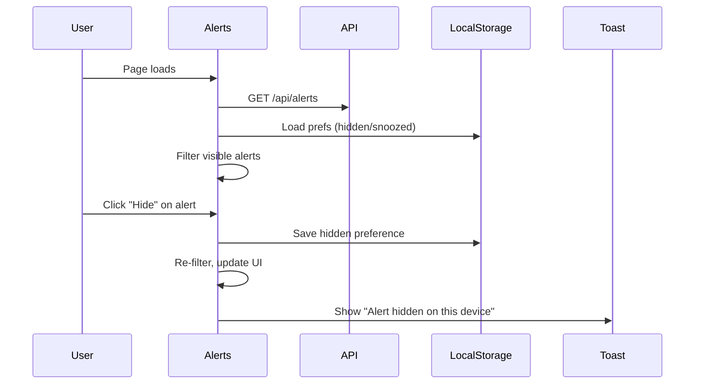

# Frontend Deep Dive

## Frontend Architecture Overview

The frontend is a **React 18** Single Page Application built with **Vite**, using **React Router v6** for navigation, **Tailwind CSS** for styling, and **Chart.js** for visualizations.

```
┌─────────────────────────────────────────────────────────────────┐
│                        App Entry (main.jsx)                      │
│  BrowserRouter → ThemeProvider → ToastProvider → App            │
└────────────────────────────┬────────────────────────────────────┘
                             │
┌────────────────────────────▼────────────────────────────────────┐
│                          App.jsx (Routes)                        │
│  Public: /login, /register, / (RootSwitch)                      │
│  Protected: /dashboard, /farms, /assess, /assessments/:id,      │
│             /compare, /alerts, /history                         │
└────────────────────────────┬────────────────────────────────────┘
                             │
        ┌────────────────────┼────────────────────┐
        ▼                    ▼                    ▼
┌───────────────┐    ┌───────────────┐    ┌───────────────┐
│   Pages       │    │  Components   │    │   Services    │
│ (Route-level) │    │  (Reusable)   │    │  (API, Utils) │
└───────────────┘    └───────────────┘    └───────────────┘
```

---

## Pages, Screens and Components

### Page Components (`src/pages/`)

| Page | Route | Purpose | Key Features |
|------|-------|---------|--------------|
| **Landing** | `/` (unauthenticated) | Public landing page | Hero, features, CTA to login/register |
| **Login** | `/login` | User authentication | Form validation, show/hide password, rate limit handling |
| **Register** | `/register` | User registration | Form validation, password strength, auto-navigate to login |
| **Dashboard** | `/dashboard` | User overview | Stats, charts (ratio trend, suitability mix), recent assessments, alerts, quick actions |
| **Farms** | `/farms` | Farm management | List farms, add farm form, map picker, geocoding, water calculators |
| **Assess** | `/assess` | New assessment wizard | 3-step: Farm → Crop/Period → Review/Run |
| **Result** | `/assessments/:id` | Assessment detail | Gauge, charts, tables, CSV export, print, advice |
| **Compare** | `/compare` | Multi-crop comparison | Checkbox crop selection, sorted cards, bar chart, comparison table |
| **Alerts** | `/alerts` | High-stress alerts | Hide/snooze (localStorage), view assessment links |
| **History** | `/history` | Assessment history | Filterable, sortable, paginated table |

### Layout Components (`src/components/`)

| Component | Purpose |
|-----------|---------|
| **AppShell** | Authenticated layout with sidebar navigation, user menu, logout |
| **ProtectedRoute** | Redirects to `/login` if no token in localStorage |
| **RootSwitch** | Redirects to `/dashboard` if token exists, else renders Landing |
| **FarmMap** | Leaflet map for picking farm location (click to set lat/lon) |
| **RatioGauge** | SVG circular gauge showing water ratio (0-1.5+) |
| **ThemeToggle** | Button to switch dark/light theme |
| **Layout** | Page wrapper with consistent spacing |

### UI Primitives (`src/components/ui/`)

| Component | Purpose | Props |
|-----------|---------|-------|
| **Button** | Primary, secondary, ghost variants; loading state | `variant`, `size`, `loading`, `disabled` |
| **Card** | Container with glass effect, hover variant | `className`, `hover` |
| **Badge** | Colored label with tones (success, warning, danger, info, neutral) | `tone`, `children` |
| **Input** | Styled input with label, error state | `label`, `error`, `type`, `...props` |
| **Select** | Styled select dropdown | `label`, `options`, `value`, `onChange` |
| **StatCard** | Icon + label + value display | `icon`, `label`, `value`, `valueClassName` |
| **ProgressRing** | Circular progress with center content | `value` (0-100), `label`, `size`, `children` |
| **Skeleton** | Loading placeholder | `className` |
| **EmptyState** | Illustration + title + text + action | `icon`, `title`, `text`, `action` |
| **Toast** | Notification system (success, error, info) | Context: `success()`, `error()`, `info()` |

---

## Routing/Navigation

### Route Configuration (`App.jsx`)

```jsx
<Routes>
  {/* Public routes */}
  <Route path="/login" element={<Login />} />
  <Route path="/register" element={<Register />} />
  <Route path="/" element={<RootSwitch />} />
  
  {/* Protected routes - wrapped in ProtectedRoute + AppShell */}
  <Route element={
    <ProtectedRoute>
      <AppShell />
    </ProtectedRoute>
  }>
    <Route path="dashboard" element={<Dashboard />} />
    <Route path="farms" element={<Farms />} />
    <Route path="assess" element={<Assess />} />
    <Route path="assessments/:id" element={<Result />} />
    <Route path="compare" element={<Compare />} />
    <Route path="alerts" element={<Alerts />} />
    <Route path="history" element={<History />} />
  </Route>
  
  {/* Catch-all */}
  <Route path="*" element={<Navigate to="/" replace />} />
</Routes>
```

### Navigation Flow



### ProtectedRoute Implementation

```jsx
// src/components/ProtectedRoute.jsx
export default function ProtectedRoute({ children }) {
  if (!getToken()) {
    return <Navigate to="/login" replace />
  }
  return children
}
```

### RootSwitch Implementation

```jsx
// src/components/RootSwitch.jsx
export default function RootSwitch() {
  return getToken() ? <Navigate to="/dashboard" replace /> : <Landing />;
}
```

---

## State Management

### Global State (React Context)

#### Theme Context (`src/theme/ThemeProvider.jsx`)
```jsx
export const ThemeContext = createContext({
  theme: 'light',
  toggle: () => {},
});

export function ThemeProvider({ children }) {
  const [theme, setTheme] = useState(() => {
    // Initialize from localStorage or system preference
    const stored = localStorage.getItem('jk_theme');
    if (stored === 'light' || stored === 'dark') return stored;
    if (window.matchMedia('(prefers-color-scheme: dark)').matches) return 'dark';
    return 'light';
  });

  useEffect(() => {
    document.documentElement.classList.toggle('dark', theme === 'dark');
    localStorage.setItem('jk_theme', theme);
  }, [theme]);

  const toggle = () => setTheme(prev => prev === 'dark' ? 'light' : 'dark');

  return (
    <ThemeContext.Provider value={{ theme, toggle }}>
      {children}
    </ThemeContext.Provider>
  );
}
```

#### Toast Context (`src/components/ui/Toast.jsx`)
```jsx
export const ToastContext = createContext({
  success: () => {},
  error: () => {},
  info: () => {},
});

export function ToastProvider({ children }) {
  const [items, setItems] = useState([]);
  
  const addToast = (type, message) => {
    const id = ++idCounter.current;
    setItems(prev => [...prev, { id, type, message }].slice(-3));
  };
  
  // Auto-dismiss after 4s (6s for errors)
  useEffect(() => { /* setTimeout cleanup */ }, [items]);
  
  return (
    <ToastContext.Provider value={{ success, error, info }}>
      {children}
      <div className="fixed bottom-24 lg:bottom-6 right-4 z-[60]...">
        {items.map(item => /* Toast UI */)}
      </div>
    </ToastContext.Provider>
  );
}
```

### Local Component State

Pages use `useState` for:
- Form inputs
- Loading/saving states
- Error messages
- Selected items (farm, crop, horizon)
- Wizard step (Assess page)

### Server State

Fetched via `useEffect` on mount:
- Dashboard: Parallel `Promise.all` for user, farms, assessments, alerts
- Farms: Single fetch on mount
- Assess: Parallel fetch farms + crops
- Result: Fetch report by ID
- Compare: Parallel fetch farms + crops
- Alerts: Fetch alerts on mount
- History: Parallel fetch assessments, farms, crops

**No caching library** (React Query, SWR) - simple `useEffect` pattern.

---

## API Integration

### Axios Instance (`src/api.js`)

```javascript
import axios from 'axios'

export const TOKEN_KEY = 'jk_token'

export function getToken() {
  try { return localStorage.getItem(TOKEN_KEY) } catch { return null }
}

export function setToken(token) {
  try { localStorage.setItem(TOKEN_KEY, token) } catch {}
}

export function clearToken() {
  try { localStorage.removeItem(TOKEN_KEY) } catch {}
}

export const api = axios.create({
  baseURL: import.meta.env.VITE_API_URL || 'http://localhost:8080'
})

// Request interceptor: attach JWT
api.interceptors.request.use((config) => {
  const token = getToken()
  if (token) config.headers.Authorization = `Bearer ${token}`
  return config
})

// Response interceptor: handle 401
api.interceptors.response.use(
  (response) => response,
  (error) => {
    if (error.response && error.response.status === 401) {
      clearToken()
    }
    return Promise.reject(error)
  }
)
```

### API Call Patterns

#### Parallel Data Fetching (Dashboard)
```javascript
useEffect(() => {
  async function fetchData() {
    try {
      const [meRes, farmsRes, assessmentsRes, alertsRes] = await Promise.all([
        api.get("/api/auth/me"),
        api.get("/api/farms"),
        api.get("/api/assessments"),
        api.get("/api/alerts"),
      ]);
      setName(meRes.data.name);
      setFarms(farmsRes.data);
      setAssessments(assessmentsRes.data);
      setAlerts(alertsRes.data);
    } catch (err) {
      if (err.response?.status === 401) {
        clearToken();
        navigate("/login");
      } else {
        setError(true);
      }
    } finally {
      setLoading(false);
    }
  }
  fetchData();
}, [navigate]);
```

#### Form Submission with Loading State
```javascript
async function handleSubmit(e) {
  e.preventDefault();
  setSaving(true);
  setSaveError(null);
  try {
    const res = await api.post("/api/assessments", {
      farmId, cropId, horizonDays: Number(horizon)
    });
    navigate("/assessments/" + res.data.id);
  } catch (err) {
    setSaveError(err.response?.data?.message || "Could not run assessment");
  } finally {
    setSaving(false);
  }
}
```

#### Error Handling
```javascript
// Component-level error state
const [error, setError] = useState(null);

// In catch block
setSaveError(err.response?.data?.message || "Could not run assessment");

// In JSX
{saveError && (
  <div className="bg-red-50 text-red-700 border border-red-200 rounded-xl p-3 mb-4" role="alert">
    {saveError}
  </div>
)}
```

---

## Forms and Validation

### Client-Side Validation

#### Login Form
```javascript
function validateEmail(email) {
  return /^[^\s@]+@[^\s@]+\.[^\s@]+$/.test(email);
}

async function handleSubmit(e) {
  e.preventDefault();
  setError(""); setEmailError(""); setPasswordError("");
  
  let hasError = false;
  if (!email) { setEmailError("Enter a valid email address"); hasError = true; }
  else if (!validateEmail(email)) { setEmailError("Enter a valid email address"); hasError = true; }
  if (!password) { setPasswordError("Enter your password"); hasError = true; }
  if (hasError) return;
  
  // ... API call
}
```

#### Farm Form (Complex)
```javascript
// Real-time validation on blur
onBlur={() => {
  if (email && !validateEmail(email)) {
    setEmailError("Enter a valid email address");
  }
}}

// Inline error display
{emailError && (
  <p id="email-error" className="mt-1 text-sm text-rose-600" role="alert">
    {emailError}
  </p>
)}

// Input with error styling
className={`input-glass w-full py-3 px-4 ${emailError ? "border-rose-500 focus:ring-rose-500" : ""}`}
aria-invalid={emailError ? "true" : "false"}
aria-describedby={emailError ? "email-error" : undefined}
```

### Server-Side Validation Handling

Backend returns 400 with field errors:
```json
{
  "timestamp": "...",
  "status": 400,
  "error": "Bad Request",
  "message": "name: name must not be blank; areaHa: areaHa must be > 0"
}
```

Frontend displays generic message:
```javascript
setSaveError(err.response?.data?.message || "Could not save farm");
```

---

## Authentication State

### Token Management
- **Storage**: `localStorage` (key: `jk_token`)
- **Persistence**: Survives browser refresh
- **Expiry**: Handled by backend (120 min), frontend clears on 401

### Auth Flow


### Logout
```javascript
// In AppShell.jsx
function handleLogout() {
  clearToken();
  navigate("/login");
}
```

---

## Data Rendering

### Charts (Chart.js)

#### Theme-Aware Colors (`src/chartTheme.js`)
```javascript
export const chartColors = (theme) => ({
  supply: theme === 'dark' ? '#4ade80' : '#16a34a',
  demand: theme === 'dark' ? '#f87171' : '#dc2626',
  text: theme === 'dark' ? '#e5e7eb' : '#1f2937',
  grid: theme === 'dark' ? '#374151' : '#e5e7eb',
  warn: theme === 'dark' ? '#fbbf24' : '#f59e0b',
});
```

#### Chart Components
```javascript
// Dashboard - Line chart (ratio over time)
<Line data={lineData} options={lineOptions} />

// Dashboard - Doughnut chart (suitability mix)
<Doughnut data={doughnutData} options={doughnutOptions} />

// Result - Bar chart (supply vs demand by horizon)
<Bar data={chartData} options={chartOptions} />

// Compare - Horizontal bar chart (crop comparison)
<Bar data={...} options={{ indexAxis: 'y', ... }} />
```

#### Memoization (Prevent Re-renders)
```javascript
const lineData = useMemo(() => { /* compute data */ }, [assessments, colors]);
const lineOptions = useMemo(() => ({ /* options */ }), [colors]);
```

### Tables

#### History Table (Sortable, Filterable, Paginated)
```javascript
const filtered = useMemo(() => {
  if (!filter) return assessments;
  return assessments.filter(a => a.suitability === filter);
}, [assessments, filter]);

const sorted = useMemo(() => {
  const { key, direction } = sortConfig;
  return [...filtered].sort((a, b) => {
    let aVal = a[key], bVal = b[key];
    if (key === 'ratio' || key === 'horizonDays') {
      aVal = Number(aVal); bVal = Number(bVal);
    } else if (key === 'createdAt') {
      aVal = new Date(aVal).getTime(); bVal = new Date(bVal).getTime();
    }
    // ... compare
  });
}, [filtered, sortConfig]);

// Pagination
const PAGE_SIZE = 10;
const totalPages = Math.ceil(total / PAGE_SIZE) || 1;
const paged = sorted.slice(start, end);
```

### Conditional Rendering

#### Loading Skeletons
```javascript
if (loading) {
  return (
    <div role="status" className="p-4">
      <span className="sr-only">Loading dashboard...</span>
      <div className="grid gap-4 grid-cols-1 sm:grid-cols-2 lg:grid-cols-4">
        <Skeleton className="h-28" />
        <Skeleton className="h-28" />
        {/* ... more skeletons matching layout */}
      </div>
    </div>
  );
}
```

#### Empty States
```javascript
{assessments.length === 0 && (
  <EmptyState
    icon={() => <svg>...</svg>}
    title="No assessments yet."
    text="Run your first assessment to see water suitability for your crops."
    action={<Link to="/assess">Run your first assessment</Link>}
  />
)}
```

---

## Component Relationships

### Component Tree (Authenticated)

```
AppShell
├── Sidebar (Navigation)
│   ├── NavLink → Dashboard
│   ├── NavLink → Farms
│   ├── NavLink → Assess
│   ├── NavLink → Compare
│   ├── NavLink → Alerts
│   └── NavLink → History
├── Header
│   ├── ThemeToggle
│   ├── User Menu (name, logout)
│   └── Mobile Menu Button
└── Main Content (Outlet)
    ├── Dashboard
    │   ├── StatCard × 4
    │   ├── ProgressRing
    │   ├── Line Chart
    │   ├── Doughnut Chart
    │   ├── Alert Cards
    │   └── Recent Assessments List
    ├── Farms
    │   ├── FarmMap
    │   ├── Farm Form (with water calculators)
    │   └── Farm Cards Grid
    ├── Assess (Wizard)
    │   ├── Step 1: Farm Select + Summary
    │   ├── Step 2: Crop Select + Horizon
    │   └── Step 3: Review + Run
    ├── Result
    │   ├── RatioGauge
    │   ├── Water Balance Card
    │   ├── Weather Card
    │   ├── Bar Chart
    │   ├── Breakdown Table
    │   └── Action Buttons (CSV, Print)
    ├── Compare
    │   ├── Farm Select
    │   ├── Crop Checkboxes
    │   ├── Horizon Select
    │   ├── Result Cards (with winner highlight)
    │   ├── Bar Chart
    │   └── Comparison Table
    ├── Alerts
    │   └── Alert Cards (with hide/snooze)
    └── History
        ├── Filter Dropdown
        ├── Sortable Table (with pagination)
        └── View Links
```

### Shared Components Usage

| Component | Used In |
|-----------|---------|
| `Button` | All pages (forms, actions, navigation) |
| `Card` | All pages (containers) |
| `Badge` | Dashboard, Result, Compare, History (suitability, stress) |
| `StatCard` | Dashboard (stats) |
| `ProgressRing` | Dashboard (health ring) |
| `Skeleton` | All pages (loading) |
| `EmptyState` | Dashboard, Farms, History, Alerts |
| `Toast` | Global (Farms, Assess, Alerts) |
| `RatioGauge` | Result (hero) |
| `FarmMap` | Farms (location picker) |
| `ThemeToggle` | Login, Register, AppShell |

---

## Important User Interactions

### 1. Farm Creation with Map


### 2. Assessment Wizard (3 Steps)


### 3. Crop Comparison


### 4. Alert Management


---

## Utility Modules

### Water Math (`src/waterMath.js`)
```javascript
export function acresToHa(acres) { /* ... */ }
export function bucketToPerDay({ bucketLitres, seconds, hoursPerDay }) { /* ... */ }
export function tankLitres({ length, width, depth, unit }) { /* ... */ }
export function perDayFromTotal(totalLitres, days) { /* ... */ }
export function haToAcres(ha) { /* ... */ }
```

### Geocoding (`src/geocode.js`)
```javascript
export async function searchPlaces(parts, { delayMs = 1100, fetchImpl = fetch } = {}) {
  // Build query from country, state, district, taluka, village
  // Call Nominatim API
  // Retry without taluka if no results
  // Return [{ label, lat, lon }]
}
```

### Labels (`src/labels.js`)
```javascript
export const suitabilityLabel = { EXCELLENT: "Excellent", ... };
export const suitabilityColor = { EXCELLENT: "#16a34a", ... };
export const stressLabel = { LOW: "Low", LOW_MODERATE: "Low-moderate", ... };
export const suitabilityBadge = { EXCELLENT: { bg: "#15803d", fg: "#ffffff" }, ... };
```

### CSV Export (`src/reportCsv.js`)
```javascript
export function toCsv(report) {
  // Convert report (assessment + breakdown) to CSV string
  // Includes: assessment details, breakdown rows
}
```

### Farm Info Helpers (`src/farmInfo.js`)
```javascript
export function locationLine(farm) { /* Format: village, taluka, district, state, country */ }
export function waterChips(farm) { /* Return array of water display strings */ }
```

---

## Testing

### Test Setup (`src/setupTests.js`)
```javascript
import { cleanup } from '@testing-library/react';
import { afterEach, vi } from 'vitest';
import '@testing-library/jest-dom';

afterEach(() => { cleanup(); });

// Mock ResizeObserver for Chart.js
global.ResizeObserver = vi.fn().mockImplementation(() => ({
  observe: vi.fn(), unobserve: vi.fn(), disconnect: vi.fn()
}));

// Mock matchMedia for ThemeProvider
Object.defineProperty(window, 'matchMedia', {
  writable: true,
  value: vi.fn().mockImplementation(query => ({
    matches: false, media: query, onchange: null,
    addListener: vi.fn(), removeListener: vi.fn(),
    addEventListener: vi.fn(), removeEventListener: vi.fn(), dispatchEvent: vi.fn()
  }))
});
```

### Test Categories
| Test File | Component | Tests |
|-----------|-----------|-------|
| `Login.test.jsx` | Login | Render, validation, submit, navigation |
| `Register.test.jsx` | Register | Render, validation, submit |
| `Dashboard.test.jsx` | Dashboard | Render, loading, data display, charts |
| `Farms.test.jsx` | Farms | Render, form, map, water calculators |
| `Assess.test.jsx` | Assess | Wizard steps, validation, submission |
| `Result.test.jsx` | Result | Render, charts, CSV, print |
| `Compare.test.jsx` | Compare | Selection, comparison, results |
| `Alerts.test.jsx` | Alerts | Render, hide, snooze, show all |
| `History.test.jsx` | History | Table, filter, sort, pagination |
| `*.test.jsx` | UI Primitives | Button, Card, Badge, ProgressRing, etc. |

### Running Tests
```bash
cd frontend
npm test          # Run all tests with Vitest
npm run test:ui   # With UI
npm run test:run  # CI mode (no watch)
```