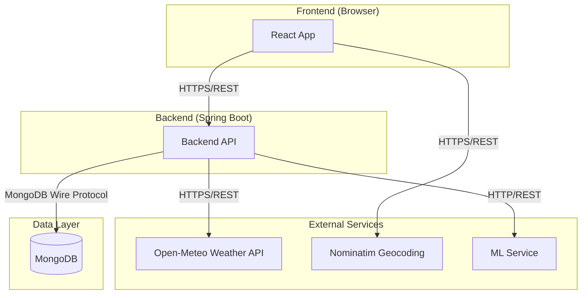

# Integrations and Connections

## Overview

This document details every connection in the JalKrishi AI system, including configuration, data flow, and troubleshooting.



---

## 1. Frontend → Backend

### Configuration

**Frontend** (`frontend/.env.example`):
```env
VITE_API_URL=http://localhost:8080
```

**Backend** (`backend/src/main/resources/application.yml`):
```yaml
jalkrishi:
  cors:
    allowed-origin: ${CORS_ORIGIN:http://localhost:5173}
```

**CORS Config** (`CorsConfig.java`):
```java
@Bean
public CorsConfigurationSource corsConfigurationSource() {
    CorsConfiguration config = new CorsConfiguration();
    config.setAllowedOrigins(List.of(allowedOrigin));
    config.setAllowedMethods(List.of("GET", "POST", "PUT", "DELETE", "OPTIONS"));
    config.setAllowedHeaders(List.of("Authorization", "Content-Type"));
    config.setAllowCredentials(true);
    // ...
}
```

### Data Flow

```
User Action → React Component → api.js (Axios) → HTTP Request → Backend Controller
                                                              ↓
Response ← JSON ← Backend Controller ← Business Logic ← Database/External APIs
```

### Request Headers
```
Content-Type: application/json
Authorization: Bearer <JWT_TOKEN>  (added by api.js interceptor)
```

### Authentication
- JWT in `Authorization` header
- Token stored in `localStorage` (key: `jk_token`)
- Auto-cleared on 401 response

### Troubleshooting

| Issue | Cause | Solution |
|-------|-------|----------|
| CORS Error | Frontend origin not in allowed list | Check `CORS_ORIGIN` env var matches frontend URL |
| 401 Unauthorized | Token expired or invalid | User redirected to login; check JWT_SECRET matches |
| Network Error | Backend not running | Verify backend on port 8080; check Docker health |
| 500 Internal Error | Backend exception | Check backend logs; see GlobalExceptionHandler |

### Health Check
```bash
curl http://localhost:8080/health
# Expected: {"status":"UP"}
```

---

## 2. Backend → MongoDB

### Configuration

**application.yml**:
```yaml
spring:
  data:
    mongodb:
      database: jalkrishi
      uri: ${SPRING_DATA_MONGODB_URI:mongodb://localhost:27017}
```

**Docker Compose**:
```yaml
services:
  mongo:
    image: mongo:7
    volumes:
      - mongo_data:/data/db
  backend:
    environment:
      SPRING_DATA_MONGODB_URI: mongodb://mongo:27017
    depends_on:
      mongo:
        condition: service_healthy
```

### Connection Details

| Setting | Value |
|---------|-------|
| Host | `mongo` (Docker) / `localhost` (local) |
| Port | 27017 |
| Database | `jalkrishi` |
| Authentication | None (dev) |
| Driver | Spring Data MongoDB (blocking) |

### Collections
- `users` - User accounts
- `farms` - Farm definitions
- `crops` - Crop catalog (seeded)
- `assessments` - Assessment results

### Indexes
```javascript
// users
db.users.createIndex({ "email": 1 }, { unique: true })

// farms
db.farms.createIndex({ "ownerId": 1 })

// assessments
db.assessments.createIndex({ "ownerId": 1 })
db.assessments.createIndex({ "ownerId": 1, "stress": 1, "createdAt": -1 })
db.assessments.createIndex({ "_id": 1, "ownerId": 1 })
```

### Data Flow

```
Repository Method → Spring Data MongoDB → MongoDB Driver → MongoDB Server
                                                              ↓
Response ← Document ← MongoDB Driver ← MongoDB Server ← Query Execution
```

### Troubleshooting

| Issue | Cause | Solution |
|-------|-------|----------|
| Connection Refused | MongoDB not running | `docker compose up mongo` or start local MongoDB |
| Authentication Failed | Wrong credentials | Check `SPRING_DATA_MONGODB_URI` |
| Query Slow | Missing index | Verify indexes exist; check `explain()` |
| Data Not Persisted | Volume not mounted | Check `mongo_data` volume in docker-compose |

### Health Check
```bash
# Docker
docker exec mongo mongosh --quiet --eval "db.adminCommand('ping').ok"
# Expected: 1

# Application
curl http://localhost:8080/health
# Backend health includes MongoDB connectivity
```

---

## 3. Backend → Open-Meteo Weather API

### Configuration

**application.yml**:
```yaml
jalkrishi:
  weather:
    base-url: https://api.open-meteo.com
    connect-timeout: 5000
    read-timeout: 10000
```

**WebClientConfig.java** (`weatherWebClient` bean):
```java
@Bean("weatherWebClient")
public WebClient weatherWebClient(HttpClient httpClient, @Value("${jalkrishi.weather.base-url}") String baseUrl, ...) {
    return WebClient.builder()
        .baseUrl(baseUrl)
        .defaultHeader(HttpHeaders.CONTENT_TYPE, MediaType.APPLICATION_JSON_VALUE)
        .clientConnector(new ReactorClientHttpConnector(httpClient))
        .filter(logRequestResponse())
        .filter(errorHandlingFilter())
        .build();
}
```

### API Request

**Endpoint**: `GET https://api.open-meteo.com/v1/forecast`

**Parameters**:
| Parameter | Value | Description |
|-----------|-------|-------------|
| latitude | Farm lat | Decimal degrees |
| longitude | Farm lon | Decimal degrees |
| daily | `temperature_2m_max,temperature_2m_min,precipitation_sum` | Required variables |
| forecast_days | 16 | Days of forecast |
| timezone | auto | Automatic timezone |

### Data Flow

```
DataService.getWeather(lat, lon)
    ↓
WebClient GET /v1/forecast?latitude=X&longitude=Y&daily=...&forecast_days=16
    ↓
Open-Meteo API
    ↓
JSON Response with daily arrays
    ↓
DataService.parse(json)
    ↓
WeatherData(tmax, tmin, ra=15.0, peffDailyMm=0.8*precipAvg, source=LIVE)
```

### Response Processing

```java
public static WeatherData parse(String json) {
    JsonNode daily = root.get("daily");
    double tmax = average(daily.get("temperature_2m_max"));
    double tmin = average(daily.get("temperature_2m_min"));
    double precipitationAvg = average(daily.get("precipitation_sum"));
    double peffDailyMm = 0.8 * precipitationAvg;  // 80% effective rainfall
    double ra = 15.0;  // Fixed extraterrestrial radiation
    return new WeatherData(tmax, tmin, ra, peffDailyMm, WeatherSource.LIVE);
}
```

### Fallback Handling

```java
public WeatherData getWeather(double lat, double lon) {
    try {
        String json = webClient.get()...block(Duration.ofSeconds(5));
        return parse(json);
    } catch (Exception e) {
        log.error("Weather API error: {}", e.getMessage());
        return fallback();  // Static values
    }
}

public static WeatherData fallback() {
    return new WeatherData(32.0, 21.0, 15.0, 1.5, WeatherSource.FALLBACK);
}
```

**Fallback Values**:
- `tmax`: 32.0°C
- `tmin`: 21.0°C
- `ra`: 15.0 mm/day
- `peffDailyMm`: 1.5 mm/day
- `source`: FALLBACK

### Troubleshooting

| Issue | Cause | Solution |
|-------|-------|----------|
| Timeout | Slow network/Open-Meteo down | Increase `read-timeout`; fallback activates |
| 429 Rate Limited | Too many requests | Open-Meteo free tier: 10,000/day; add caching |
| Parse Error | Unexpected JSON format | Check `DataService.parse()` logic; fallback activates |
| Always Fallback | Network blocked | Verify outbound HTTPS; check firewall/proxy |

### Monitoring
```bash
# Check backend logs for weather API calls
docker logs backend | grep "Weather API"

# Test directly
curl "https://api.open-meteo.com/v1/forecast?latitude=28.6139&longitude=77.2090&daily=temperature_2m_max,temperature_2m_min,precipitation_sum&forecast_days=16&timezone=auto"
```

---

## 4. Backend → ML Service

### Configuration

**application.yml**:
```yaml
jalkrishi:
  ml:
    url: ${ML_URL:http://localhost:8000}
```

**WebClientConfig.java** (`mlWebClient` bean):
```java
@Bean("mlWebClient")
public WebClient mlWebClient(HttpClient httpClient, @Value("${jalkrishi.ml.url}") String baseUrl, ...) {
    return WebClient.builder()
        .baseUrl(baseUrl)
        .defaultHeader(HttpHeaders.CONTENT_TYPE, MediaType.APPLICATION_JSON_VALUE)
        .clientConnector(new ReactorClientHttpConnector(httpClient))
        .filter(logRequestResponse())
        .filter(errorHandlingFilter())
        .build();
}
```

**Docker Compose**:
```yaml
services:
  ml-service:
    build: ./ml-service
    ports:
      - "8000:8000"
  backend:
    environment:
      ML_URL: http://ml-service:8000
    depends_on:
      ml-service:
        condition: service_healthy
```

### API Request

**Endpoint**: `POST http://ml-service:8000/predict` (internal Docker network)

**Request Body**:
```json
{
  "ratio": 1.25,
  "tmax": 32.5,
  "tmin": 21.0,
  "peffDailyMm": 2.1
}
```

**Timeout**: 3 seconds (configured in `MlClient`)

### Data Flow

```
AssessmentService.create()
    ↓
MlClient.predict(ratio, tmax, tmin, peffDailyMm)
    ↓
WebClient POST /predict with JSON body
    ↓
ML Service (FastAPI)
    ↓
If model loaded: model.predict() → {suitability, probability, source:"model"}
If model missing: rule_label_for(ratio) → {suitability, probability:1.0, source:"rules"}
    ↓
Response parsed → Optional<String> suitability
    ↓
Assessment.mlUsed = true, Assessment.mlSuitability = result
```

### ML Service Implementation (`ml-service/app/main.py`)

```python
def load_model():
    if not MODEL_PATH.exists(): return None
    try: return joblib.load(MODEL_PATH)
    except: return None

@app.post("/predict")
def predict(req: PredictRequest):
    model = load_model()
    if model is not None:
        X = pd.DataFrame([{"ratio": req.ratio, "tmax": req.tmax, "tmin": req.tmin, "peffDailyMm": req.peffDailyMm}])
        pred = model.predict(X)[0]
        proba = model.predict_proba(X)
        return {"suitability": str(pred), "probability": round(float(proba.max()), 4), "source": "model"}
    else:
        suitability = rule_label_for(req.ratio)
        return {"suitability": suitability, "probability": 1.0, "source": "rules"}

def rule_label_for(ratio: float) -> str:
    if ratio >= 1.0: return "EXCELLENT"
    elif ratio >= 0.8: return "GOOD"
    elif ratio >= 0.6: return "RISKY"
    else: return "NOT_RECOMMENDED"
```

### Model Training (`ml-service/train.py`)

```python
# Generates synthetic training data using rule-based labels
# Trains RandomForestClassifier
# Saves model.joblib and metrics.json
```

### Troubleshooting

| Issue | Cause | Solution |
|-------|-------|----------|
| Connection Refused | ML service not running | `docker compose up ml-service` |
| 500 Error | Model loading failed | Check `model.joblib` exists; run `train.py` |
| Timeout | Model inference slow | Increase timeout in `MlClient` (currently 3s) |
| Always "rules" source | model.joblib missing | Run `python train.py` in ml-service |
| Different Results | Model vs rules mismatch | Model trained on synthetic rule data; expect similarity |

### Health Check
```bash
# ML Service
curl http://localhost:8000/health
# Expected: {"status":"UP"}

# Test Prediction
curl -X POST http://localhost:8000/predict \
  -H "Content-Type: application/json" \
  -d '{"ratio":1.2,"tmax":32,"tmin":21,"peffDailyMm":1.5}'
```

---

## 5. Frontend → Nominatim (OpenStreetMap Geocoding)

### Configuration

No backend configuration - direct from frontend.

**Implementation** (`src/geocode.js`):
```javascript
export async function searchPlaces(parts, { delayMs = 1100, fetchImpl = fetch } = {}) {
    const queryParts = [village, taluka, district, state, country].filter(Boolean);
    const query = queryParts.join(', ');
    
    const url = 'https://nominatim.openstreetmap.org/search?format=jsonv2&limit=5&accept-language=en&q=' + encodeURIComponent(query);
    
    const response = await fetchImpl(url, { headers: { Accept: 'application/json' } });
    // ... parse results
    
    // Retry without taluka if no results
}
```

### Rate Limiting
- **Policy**: 1 request/second (Nominatim usage policy)
- **Implementation**: 1100ms delay between retry attempts
- **User-Agent**: Should be set (currently uses default)

### Data Flow

```
User enters location fields → Farms.handleSearch()
    ↓
searchPlaces({country, state, district, taluka, village})
    ↓
GET https://nominatim.openstreetmap.org/search?format=jsonv2&limit=5&q=...
    ↓
Nominatim API
    ↓
JSON Response: [{display_name, lat, lon}, ...]
    ↓
Farms: Display results → User selects → Auto-fill lat/lon
```

### Troubleshooting

| Issue | Cause | Solution |
|-------|-------|----------|
| No Results | Query too specific | Retry logic removes taluka; try fewer fields |
| 403 Forbidden | Missing User-Agent | Add `User-Agent` header with app info |
| Rate Limited | Too many requests | Respect 1 req/sec; increase `delayMs` |
| CORS Error | Browser blocks | Nominatim allows CORS; check network tab |

### Best Practices
```javascript
// Recommended: Add proper User-Agent
const response = await fetchImpl(url, { 
  headers: { 
    Accept: 'application/json',
    'User-Agent': 'JalKrishi AI/1.0 (contact@example.com)'
  } 
});
```

---

## 6. Frontend → Backend (WebSocket/SSE)

**Not Implemented** - All communication is request-response REST.

---

## 7. Infrastructure Connections

### Docker Network

```yaml
# docker-compose.yml creates default network
services:
  mongo:
  ml-service:
  backend:
  frontend:
```

**Internal DNS**:
- `mongo:27017` → MongoDB
- `ml-service:8000` → ML Service
- `backend:8080` → Backend (not directly accessed by frontend in Docker)
- Frontend served by Nginx on port 80, mapped to host 5173

### Port Mapping

| Service | Container Port | Host Port | Access |
|---------|---------------|-----------|--------|
| MongoDB | 27017 | 27017 (internal only) | Backend only |
| ML Service | 8000 | 8000 | Backend (internal), Debug (host) |
| Backend | 8080 | 8080 | Frontend (host), Debug |
| Frontend (Nginx) | 80 | 5173 | Browser |
| Frontend (Vite Dev) | 5173 | 5173 | Browser (dev mode) |

### Volume Mounts

| Volume | Service | Purpose |
|--------|---------|---------|
| `mongo_data` | MongoDB | Persistent database storage |
| `./backend` | Backend | Source code (dev) |
| `./frontend` | Frontend | Source code (dev) |
| `./ml-service` | ML Service | Source code (dev) |

---

## 8. Security Connections

### TLS/SSL

| Environment | Protocol | Notes |
|-------------|----------|-------|
| Development | HTTP | Localhost, no TLS |
| Production | HTTPS | Terminate at load balancer/CDN; internal HTTP |

### Secrets Management

| Secret | Used By | Storage |
|--------|---------|---------|
| `JWT_SECRET` | Backend (JwtService) | Environment variable |
| `SPRING_DATA_MONGODB_URI` | Backend | Environment variable |
| `ML_URL` | Backend (MlClient) | Environment variable |
| `CORS_ORIGIN` | Backend (CorsConfig) | Environment variable |
| `VITE_API_URL` | Frontend (api.js) | Build-time env (Vite) |

**Never commit secrets** - use `.env` files (gitignored) or platform secret managers.

---

## 9. Connection Troubleshooting Guide

### Quick Diagnostics

```bash
# Check all services running
docker compose ps

# Check logs
docker compose logs backend
docker compose logs frontend
docker compose logs ml-service
docker compose logs mongo

# Test connectivity
# From backend container:
docker exec backend curl -fs http://ml-service:8000/health
docker exec backend curl -fs http://mongo:27017  # Won't work (Mongo wire protocol)

# From host:
curl http://localhost:8080/health
curl http://localhost:8000/health
curl http://localhost:5173
```

### Common Issues Matrix

| Symptom | Likely Cause | Check |
|---------|--------------|-------|
| Frontend shows "Could not load" | Backend down | `docker compose logs backend` |
| 401 on all API calls | JWT_SECRET mismatch | Verify same secret in backend env |
| CORS error in browser | CORS_ORIGIN wrong | Check `CORS_ORIGIN` matches frontend URL |
| Weather always "Fallback" | Open-Meteo blocked | Backend logs for "Weather API error" |
| ML always "rules" source | model.joblib missing | `ls ml-service/model.joblib` |
| Geocoding fails | Nominatim rate limit | Wait, check browser network tab |
| MongoDB connection failed | Mongo not healthy | `docker compose ps mongo` |
| Assessment fails with 500 | Backend exception | Backend logs, check GlobalExceptionHandler |

### Debug Endpoints

| Endpoint | Purpose |
|----------|---------|
| `GET /health` | Backend health (includes MongoDB) |
| `GET /api/auth/me` | Verify JWT token valid |
| `GET /api/farms` | Verify farm data access |
| `GET /api/crops` | Verify crop data (seeded) |
| `GET http://ml-service:8000/health` | ML service health |
| `POST http://ml-service:8000/predict` | Test ML prediction |

---

## 10. Connection Summary Table

| Connection | Protocol | Auth | Timeout | Retry | Fallback |
|------------|----------|------|---------|-------|----------|
| Frontend → Backend | HTTPS/REST | JWT Bearer | Axios default | No | N/A |
| Backend → MongoDB | Mongo Wire | None | Driver default | Driver | N/A |
| Backend → Open-Meteo | HTTPS/REST | None | 5s connect, 10s read | No | Static values |
| Backend → ML Service | HTTP/REST | None | 3s | No | Rule-based |
| Frontend → Nominatim | HTTPS/REST | None | Fetch default | Once (no taluka) | Map click |
| Frontend → Backend (WS) | - | - | - | - | Not implemented |